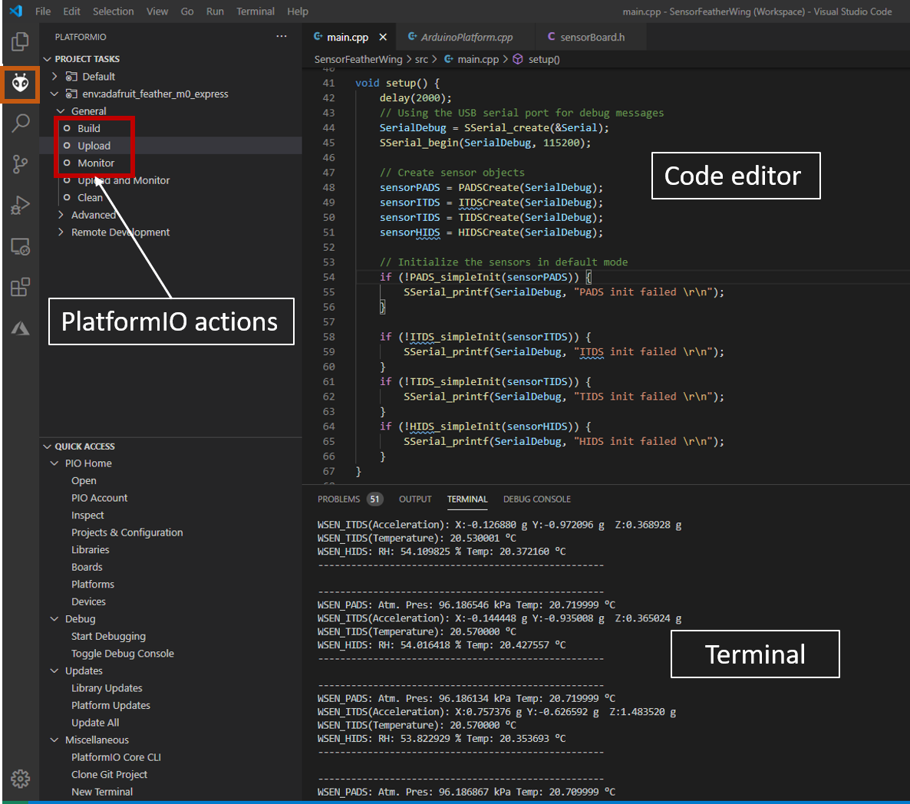

# Adrastea Thyone Bridge

## Introduction
This example implements the functionality of a bridge between the proprietary network (Thyone-I FeatherWing) and the MQTT (Adrastea-I FeatherWing). A typical IoT application consists of multiple sensor nodes that could communicate using any local network protocol to a Gateway. The Gateway inturn connects to the cloud over the internet. This example implements a gateway. On boot-up, the Adrastea-I is configured to connect to the MQTT broker over the internet. Further, the Thyone-I is configured in the receive mode. Any data that comes in via the Thyone-I module is published to a predefined topic using the Adrastea-I module.
 
### Quick start example

1. Prerequisites for running this example:
    * Mosquitto MQTT broker running in the same network. Make sure to note the IP address and the the broker is unencrypted, unauthenticated  and on port 1883. 

2. Configuration: The following parameters need to be set-up before building the code.
    * MQTT server parameters
```C
/*MQTT settings - Mosquitto server*/
#define MQTT_CLIENT_ID "adrastea"
#define MQTT_SERVER_ADDRESS "127.0.0.1"
#define MQTT_TOPIC "adrtopic"
```
3. Setup: The debug, Adrastea and Thyone UART interfaces are initialized. The Adrastea is configured with the given parameters. Further, the module waits for the network to be registered and connects to the Mosquitto MQTT server.

```C
void setup() {
    delay(3000);

#if ((WE_DEBUG_PRINT_LEVEL > WE_Debug_Print_Level_Off) || \
     defined(WE_APP_PRINT_ENABLED))
    WE_Print_Init();
#endif

    WE_APP_PRINT("Starting initialization of Adrastea...\r\n");

    AdrasteaI_uart.baudrate = 115200;
    AdrasteaI_uart.flowControl = WE_FlowControl_NoFlowControl;
    AdrasteaI_uart.parity = WE_Parity_None;
    AdrasteaI_uart.uartInit = WE_UART_RXPin0_TXPin1_Init;
    AdrasteaI_uart.uartDeinit = WE_UART_RXPin0_TXPin1_DeInit;
    AdrasteaI_uart.uartTransmit = WE_UART_RXPin0_TXPin1_Transmit;

    if (!AdrasteaI_Init(&AdrasteaI_uart, &AdrasteaI_pins,
                        Adrastea_EventCallback)) {
        WE_APP_PRINT("failed to initialize\r\n");
    }

    WE_APP_PRINT("Initialized\r\n");

    adrasteaApplicationCurrentState =
        Adrastea_Application_SM_Wait4NetworkRegister;

    while (adrasteaApplicationCurrentState !=
           Adrastea_Application_SM_MQTT_PublishData) {
        switch (adrasteaApplicationCurrentState) {
            case Adrastea_Application_SM_Wait4NetworkRegister: {
                if (!AdrasteaI_ATPacketDomain_SetNetworkRegistrationResultCode(
                        AdrasteaI_ATPacketDomain_Network_Registration_Result_Code_Enable)) {
                    WE_APP_PRINT(
                        "failed to set network registration result code\r\n");
                    adrasteaApplicationCurrentState =
                        Adrastea_Application_SM_Error;
                    break;
                }

                // read current network to mcheck if already registered
                if (!AdrasteaI_ATPacketDomain_ReadNetworkRegistrationStatus((
                        AdrasteaI_ATPacketDomain_Network_Registration_Status_t*)&status)) {
                    WE_APP_PRINT(
                        "failed to read network registration status\r\n");
                    adrasteaApplicationCurrentState =
                        Adrastea_Application_SM_Error;
                    break;
                } else if (
                    status.state ==
                    AdrasteaI_ATPacketDomain_Network_Registration_State_Registered_Roaming) {
                    adrasteaApplicationCurrentState =
                        Adrastea_Application_SM_MQTT_Connect;
                } else {
                    adrasteaApplicationCurrentState =
                        Adrastea_Application_SM_Idle;
                }
                break;
            }
            case Adrastea_Application_SM_MQTT_Connect: {
                WE_APP_PRINT("Network Registered\r\n");
                if (!AdrasteaI_ATMQTT_SetMQTTUnsolicitedNotificationEvents(
                        AdrasteaI_ATMQTT_Event_All,
                        AdrasteaI_ATCommon_Event_State_Enable)) {
                    WE_APP_PRINT("failed to enable mqtt events\r\n");
                    adrasteaApplicationCurrentState =
                        Adrastea_Application_SM_Error;
                }

                if (!AdrasteaI_ATMQTT_ConfigureNodes(
                        AdrasteaI_ATMQTT_Conn_ID_Single_Connectivity_Mode,
                        (char*)MQTT_CLIENT_ID, (char*)MQTT_SERVER_ADDRESS, NULL,
                        NULL)) {
                    WE_APP_PRINT("failed to configure node\r\n");
                    adrasteaApplicationCurrentState =
                        Adrastea_Application_SM_Error;
                }

                if (!AdrasteaI_ATMQTT_Connect(
                        AdrasteaI_ATMQTT_Conn_ID_Single_Connectivity_Mode)) {
                    WE_APP_PRINT("failed to connect\r\n");
                    adrasteaApplicationCurrentState =
                        Adrastea_Application_SM_Error;
                } else if (adrasteaApplicationCurrentState ==
                           Adrastea_Application_SM_MQTT_Connect) {
                    adrasteaApplicationCurrentState =
                        Adrastea_Application_SM_Idle;
                }
                break;
            }
            case Adrastea_Application_SM_Error: {
                return;
            }
            default:
                break;
        }
    }

    /*Set the mode pin on Setebos to Thyone-I mode*/
    SetPinMode(SETEBOS_MODE_PIN, OUTPUT);
    WritePin(SETEBOS_MODE_PIN, HIGH);

    /*Initialize the Thyone-I FeatherWing*/
    WE_APP_PRINT("Starting initialization of Thyone...\r\n");

    ThyoneI_uart.baudrate = THYONEI_DEFAULT_BAUDRATE;
    ThyoneI_uart.flowControl = WE_FlowControl_NoFlowControl;
    ThyoneI_uart.parity = WE_Parity_None;
    ThyoneI_uart.uartInit = WE_UART_RXPin11_TXPin10_Init;
    ThyoneI_uart.uartDeinit = WE_UART_RXPin11_TXPin10_DeInit;
    ThyoneI_uart.uartTransmit = WE_UART_RXPin11_TXPin10_Transmit;

    if (!ThyoneI_Init(&ThyoneI_uart, &ThyoneI_pins,
                      ThyoneI_OperationMode_CommandMode, RxCallback)) {
        WE_APP_PRINT("Thyone init failed \r\n");
    }
}
```
4. In the main application, the module waits for incoming packets from the Thyone using a callback. Once a packet arrives, it is published to the broker.
```C
/* callback for data reception */
static void RxCallback(uint8_t* payload, uint16_t payload_length,
                       uint32_t sourceAddress, int8_t rssi) {
    int i = 0;

    WE_APP_PRINT("\r\n");
    for (i = 0; i < payload_length; i++) {
        WE_APP_PRINT("%c", *(payload + i));
    }
    WE_APP_PRINT("\r\n");
    /*Publish the packet received via Adrastea-I FeatherWing*/
    payload[payload_length] = '\0';
    if (!AdrasteaI_ATMQTT_Publish(
            AdrasteaI_ATMQTT_Conn_ID_Single_Connectivity_Mode,
            AdrasteaI_ATMQTT_QoS_At_Least_Once,
            AdrasteaI_ATMQTT_Retain_Not_Retained, (char*)MQTT_TOPIC,
            (char*)payload, payload_length)) {
        WE_APP_PRINT("failed to publish\r\n");
        adrasteaApplicationCurrentState = Adrastea_Application_SM_Error;
    }
}
```
5. It is possible to view the messages on another MQTT client by subscribing to the same topic.

### Running the Example

The quick start examples in the SDK are written to be run on Adafruit Feather M0 express. The hardware setup is as simple as stacking up the FeatherWing on top of the M0 Feather and powering up the board.

1. Clone or download the code.
2. Open the workspace of interest with the filename `<FeatherWing>.code-workspace` in Visual Studio Code.
3. Build and upload the code from the PlatformIO tab as shown in the Figure below
4. After successful upload, click on **Monitor** in PlatformIO extension tab to view the debug logs in the serial terminal.

   
