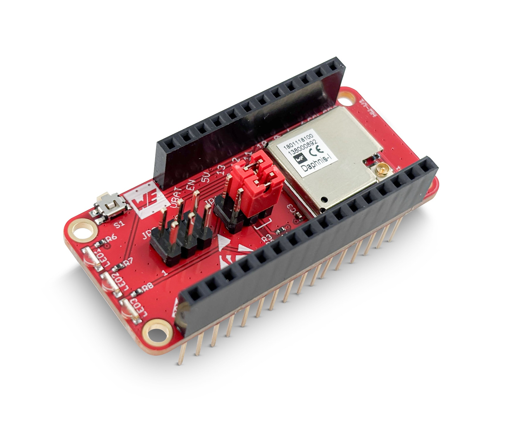
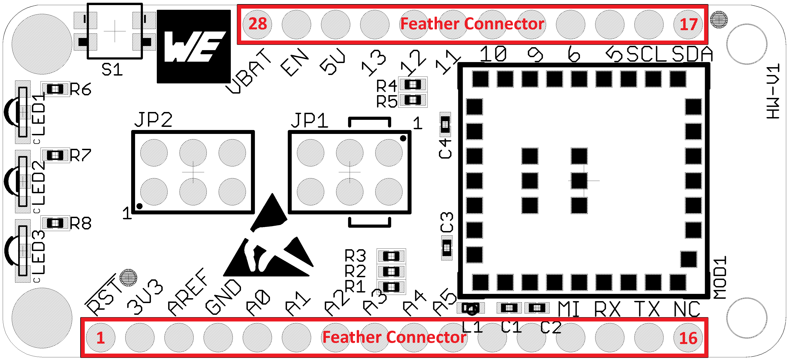
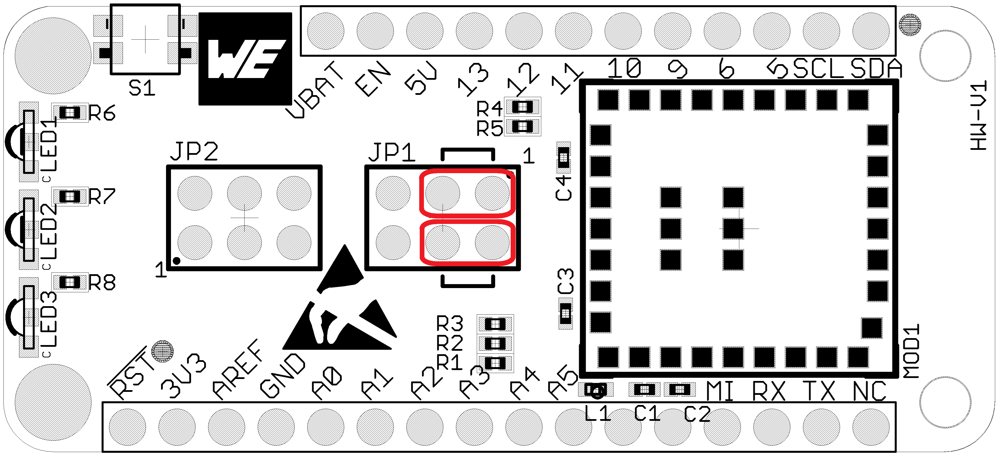
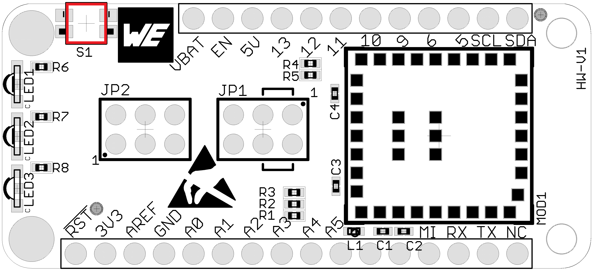
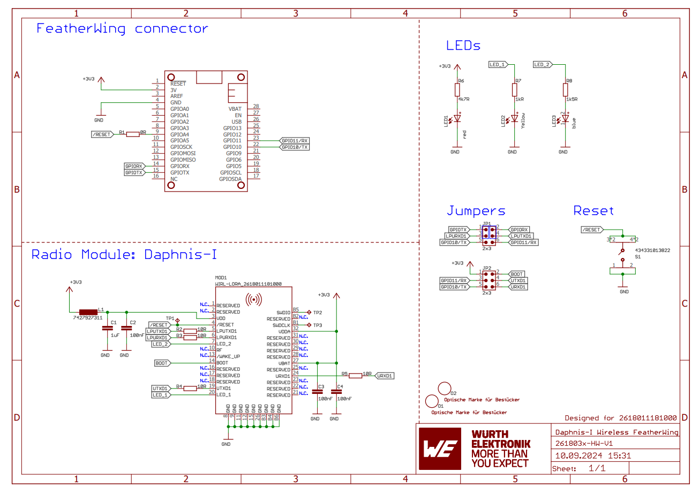

# Daphnis-I FeatherWing
## Introduction
The Würth Elektronik eiSos [**Daphnis-I LoRaWAN® FeatherWing**](https://www.we-online.com/DAPHNIS-I_FEATHERWING_KIT) is a development board that brings long-range, ultra-low-power Sub-GHz connectivity to the Adafruit Feather ecosystem. It features the [**Daphnis-I radio module**](https://www.we-online.com/DAPHNIS-I) (based on the STM32WLE5CCU6 chip), compliant with LoRaWAN® 1.0.4 (Class A/B/C) and proprietary P2P, star, and mesh modes in the EU868 band. 

Measuring just 15 × 16 × 3 mm, the module draws a mere 63.9 nA in deep sleep yet delivers up to +13.4 dBm of RF output for extended range. The AT-style UART interface makes integration with any Feather microcontroller as simple as stacking the boards on top of each other and sending commands — no radio-stack hacks required. 

With open-source [Eagle](https://www.autodesk.com/products/eagle/overview) files for the [Daphnis-I FeatherWing PCB](/hardware/) and Arduino (C/C++) libraries, plus [quick-start example](/software), you’ll be prototyping a secure LoRaWAN® IoT application in minutes.

For full specs and usage, please download the [Daphnis-I FeatherWing user manual](https://www.we-online.com/components/products/manual/2618011181000_UM_Daphnis-I_2618011181000_V1_0_rev1.1.pdf). Feel free to check out our [YouTube channel](https://www.youtube.com/user/WuerthElektronik/videos) for video tutorials, hands-on demos and webinars relating to our products.

## Hardware

### Description
The Würth Elektronik eiSos **Daphnis-I LoRaWAN® FeatherWing** was designed with rapid prototyping in mind. Fully compatible with the Adafruit Feather ecosystem, this FeatherWing allows you to choose your preferred Feather host MCU while seamlessly adding long-range, low-power Sub-GHz connectivity.

### Daphnis-I module (2618011181000)
The **Daphnis-I** module is a compact LoRa® radio solution based on the STM32WLE5CCU6 (Arm® Cortex®-M4 @ 48 MHz with integrated Semtech SX126x transceiver). Its edge-castellated pads, flexible antenna options (50 Ω RF pad or UMRF connector) and AT-style UART command interface make it easy to integrate into any embedded project.

The module supports LoRaWAN® 1.0.4 (Class A/B/C) and proprietary modes (P2P, star, mesh) in the EU868 band, with features like adaptive data rate, join-and-transmit and hardware AES-128 encryption built-in. With deep-sleep currents down to 63.9 nA and up to +13.4 dBm TX power, it’s perfect for battery-powered sensors, asset trackers and remote control nodes.

Whether you need a drop-in replacement for serial links or a secure, cloud-connected IoT endpoint, the Daphnis-I FeatherWing offers a robust, standards-compliant wireless solution for low-power, low-throughput applications.

## Key features
The Daphnis-I module offers a rich set of LoRa®-based features accessible via an easy-to-use AT-style command interface over UART.

| Feature            | Description                                                                                  |
|--------------------|----------------------------------------------------------------------------------------------|
| **Protocols**      | LoRaWAN® 1.0.4 (Class A/B/C), Proprietary LoRa® P2P, star & mesh                              |
| **Frequency band** | EU868 MHz (863 – 870 MHz)                                                                    |
| **Channels**       | Per EU868 channel plan (e.g. 0–7, RX1/RX2)                                                   |
| **TX power**       | +2 to +13.4 dBm selectable                                                                    |
| **RX sensitivity** | –138 dBm (SF12 BW125 kHz)                                                             |
| **Security**       | Hardware AES-128 (LoRaWAN payload encryption), STM32 secure boot & flash protection           |
| **Provisioning**   | OTAA & ABP join modes                                                                        |
| **Interface**      | AT-style commands over LPUART1 (PA2/PA3)                                                     |
| **Power management** | Deep‐sleep current down to 63.9 nA; pin- or timer-wake; LoRaWAN Class B/C support         |
| **I/O**            | 8× GPIOs for user I/O, 2× status LEDs, /RESET, /WAKE_UP, BOOT                                |
| **Antenna**        | 50 Ω RF pad or UMRF connector                                                                |
| **Backup domain**  | VBAT supply for RTC & 32 kHz TCXO                                                             |
| **Typical applications** | Battery-powered sensors, asset trackers, remote controls, mesh nodes                |

### Pinout

#### Feather connector

This is the standard 28-pin Feather header. On the Daphnis-I FeatherWing, only the module reset and the default UART lines are used by the module; an alternate UART pair is available via JP1.

| Pin # | Pin name   | Function                                                         |
|-----:|------------|------------------------------------------------------------------|
| 1    | RESET      | Not connected                                                    |
| 2    | 3V         | +3.3 V supply to the FeatherWing                                 |
| 3    | AREF       | Not connected                                                    |
| 4    | GND        | Ground                                                           |
| 5    | GPIOA0     | Not connected                                                    |
| 6    | GPIOA1     | Not connected                                                    |
| 7    | GPIOA2     | Not connected                                                    |
| 8    | GPIOA3     | Not connected                                                    |
| 9    | GPIO4      | **Daphnis-I RESET** (/RESET)                                     |
| 10   | GPIOA4     | Not connected                                                    |
| 11   | GPIOA5     | Not connected                                                    |
| 12   | GPIOSCK    | Not connected                                                    |
| 13   | GPIOMOSI   | Not connected                                                    |
| 14   | GPIOMISO   | Not connected                                                    |
| 15   | GPIORX     | Alternate UART RX → Daphnis-I LPUTXD1 (via JP1)                  |
| 16   | GPIOTX     | Alternate UART TX ← Daphnis-I LPURXD1 (via JP1)                  |
| 17   | GPIOSDA    | Not connected                                                    |
| 18   | GPIOSCL    | Not connected                                                    |
| 19   | GPIO5      | Not connected                                                    |
| 20   | GPIO6      | Not connected                                                    |
| 21   | GPIO9      | Not connected                                                    |
| 22   | GPIO10     | **Default UART RX** ← Daphnis-I LPURXD1 (module RX ← MCU TX)      |
| 23   | GPIO11     | **Default UART TX** → Daphnis-I LPUTXD1 (module TX → MCU RX)      |
| 24   | GPIO12     | Not connected                                                    |
| 25   | GPIO13     | Not connected                                                    |
| 26   | USB        | +5 V USB input (unused on this board)                            |
| 27   | EN         | Feather enable (tied high internally; no user connection)        |
| 28   | VBAT       | Backup-domain supply (tied to 3.3 V if no external backup used)  |

 

#### Jumper 1 - UART pin selection
The 2×3 header **JP1** lets you choose which two MCU pins talk to the Daphnis-I’s LPUART1. Moving the two shunts selects either the **factory-default** mapping or the **alternate** mapping.

| Mapping           | Shunt positions         | Module ↔ MCU connection                           |
|-------------------|-------------------------|---------------------------------------------------|
| **Default** (out-of-box)  | pins 1–3 & 2–4 (top row)   | **LPURXD1** ← **GPIOTX**     **LPUTXD1** → **GPIORX**  |
| **alternate**      | pins 3–5 & 4–6 (bottom row) | **LPURXD1** ← **GPIO10** (Feather TX)     **LPUTXD1** → **GPIO11** (Feather RX) |

- **LPURXD1** = module UART RX  
- **LPUTXD1** = module UART TX  
- **GPIOTX/GPIORX** = Daphnis-I default GPIO pair  
- **GPIO10/11** = Feather’s primary Serial1 pins (D10 = TX, D11 = RX)  

By default, the shunts are installed on the **top row**, connecting LPUART1 to the chosen default pins. To use the standard Feather Serial1 (D10/D11), move both shunts to the **bottom row**.  

#### Jumper 2 - Bootloader Mode
The 2×3 header **JP2** lets you enter the Daphnis-I system bootloader and route its bootloader-UART (UTXD1/URXD1) into your Feather MCU. Install the shunts as follows:

| Mode                  | Shunt positions        | Module ↔ MCU connection                                       |
|-----------------------|------------------------|---------------------------------------------------------------|
| **Normal operation**  | *none* (all open)      | BOOT0 ← internal pull-down (run user firmware)   UTXD1/URXD1 disconnected |
| **Firmware update**   | 1–2, 3–4 & 5–6         | BOOT0 ← +3.3 V (pull high to enter bootloader)   UTXD1 → GPIO11 (RX)   URXD1 ← GPIO10 (TX) |

- **BOOT0** = module boot-select pin (PH3)  
- **UTXD1** = module bootloader TX (pin 4 of JP2)  
- **URXD1** = module bootloader RX (pin 6 of JP2)  
- **GPIO10/11** = Feather’s Serial1 TX/RX (D10 → TX, D11 ← RX)  

By default no jumpers are fitted, so your Daphnis-I runs its LoRaWAN® firmware. To flash a new image, install all three shunts, which ties BOOT0 high and routes the module’s bootloader UART into your MCU’s Serial1 port.  

#### Push button S1
This push button is connected to the /RESET pin of the Daphnis-I module. Pressing this button resets the module.

### Schematics

### DISCLAIMER:
THE USE OF THE WÜRTH ELEKTRONIK EISOS DESIGN EXAMPLE / REFERENCE DESIGN IS ENTIRELY AT YOUR OWN RISK. IT IS YOUR SOLE RESPONSIBILITY TO IMPLEMENT THE DESIGN EXAMPLE / REFERENCE DESIGN WITH ALL TECHNICAL AND REGULATORY REQUIREMENTS IN YOUR APPLICATION. IT IS ALSO YOUR RESPONSIBILITY TO VERIFY THE FUNCTION AND PERFORMANCE OF YOUR DESIGN IN YOUR OWN PARTICULAR ENGINEERING AND PRODUCT ENVIRONMENT AND YOU ASSUME THE ENTIRE RISK OF DOING SO OR FAILING TO DO SO. THE WÜRTH ELEKTRONIK EISOS DESIGN EXAMPLE / REFERENCE DESIGN IS PROVIDED ON AN "AS IS" OR "AS AVAILABLE" BASIS, WITHOUT ANY WARRANTIES OF ANY KIND AND WÜRTH ELEKTRONIK EISOS DISCLAIMS ANY WARRANTIES EXPRESS OR IMPLIED, INCLUDING WITHOUT LIMITATION THE MERCHANTABILITY OR FITNESS FOR A PARTICULAR PURPOSE, USAGE OR THE NON-INFRINGEMENT OF THIRD PARTIES’ INTELLECTUAL PROPERTY RIGHTS. NO LICENSE IS GRANTED TO ANY INTELLECTUAL PROPERTY RIGHT BY WÜRTH ELEKTRONIK EISOS OR ANY THIRD PARY. UNDER NO CIRCUMSTANCES SHALL WÜRTH ELEKTRONIK EISOS BE LIABLE FOR DAMAGES INCURRED BY REASON OF OTHER SERVICES OR PRODUCTS RECEIVED THROUGH OR ADVERTISED IN CONNECTION WITH THE WÜRTH ELEKTRONIK EISOS SITE OR THE WÜRTH ELEKTRONIK EISOS DESIGN EXAMPLE / REFERENCE DESIGN. THE WÜRTH ELEKTRONIK EISOS DESIGN EXAMPLE / REFERENCE DESIGN IS SUBJECT TO CHANGE WITHOUT NOTICE.

## Software
You can find two examples for the Daphnis-I LoRaWAN® FeatherWing.

1. Secure connection to a LNS network and further to the cloud can be found in the [software folder](./software).
2. A simple P2P example can be found [here](../DaphnisIP2PFeatherWing/).