**Table of Contents:** 
- [Introduction](#introduction)
- [Configuring the LoRaWAN Gateway](#configuring-the-lorawan-gateway)
  - [How LoRaWAN Communication Works](#how-lorawan-communication-works)
  - [Prerequisites](#prerequisites)
  - [Configuring the LoRaWAN Gateway](#configuring-the-lorawan-gateway-1)
  - [Further Resources](#further-resources)
- [Registering the Daphnis-I FeatherWing as a Device on AWS](#registering-the-daphnis-i-featherwing-as-a-device-on-aws)
  - [Generate your own AppEUI and AppKey.](#generate-your-own-appeui-and-appkey)
  - [Onboarding your Device on AWS](#onboarding-your-device-on-aws)
    - [Steps to Onboard Your Wireless Device](#steps-to-onboard-your-wireless-device)
    - [Step 1: Adding your Wireless Device and creating a Profile with the Wireless Device Specification](#step-1-adding-your-wireless-device-and-creating-a-profile-with-the-wireless-device-specification)
    - [Step 2: Create a Device Profile](#step-2-create-a-device-profile)
    - [Step 3: Create an AWS Destination](#step-3-create-an-aws-destination)
    - [Step 4: Create an AWS Rule for further data processing](#step-4-create-an-aws-rule-for-further-data-processing)
      - [Step 4.1: Give Lambda Function\`s Execution Role Necessary Permission](#step-41-give-lambda-functions-execution-role-necessary-permission)
    - [Step 5: Connect the Device](#step-5-connect-the-device)
    - [Further Resources:](#further-resources-1)

<br>
<br>

# Introduction

In this guide, we will walk you through the process of configuring your LoRaWAN gateway and connecting it to [Amazon Web Services IoT Core (AWS)](https://aws.amazon.com/de/iot-core/). There are two main components to this setup: 
1. Configuring the gateway to communicate with the network server (AWS).
2. Configuring the network server (AWS) to work with the Daphnis-I-FeatherWing: 

Understanding how communication in the LoRaWAN network works, including the protocols used and the flow of data, is helpful for a successful set up.


# Configuring the LoRaWAN Gateway 
This section will provide a comprehensive guide on how to setup your gateway to communicate directly with the AWS network server.   
If you have never worked with AWS before, we recommend using the TTN (The Things Network) first since TTN offers an easier set up with the possibility to quickly integrate (mostly automated) with AWS, later. For more information on how to set up TTN, please refer to the [TTN Documentation](../TTN/TTN_integration.md).

## How LoRaWAN Communication Works

LoRaWAN (Long Range Wide Area Network) is a communication protocol designed for low-power, long-range communication between IoT devices. It operates in unlicensed ISM bands and uses a star-of-stars topology. A star-of-stars topology is a network configuration where multiple star networks are interconnected. In a star network, each device is connected to a central hub. In a star-of-stars topology, these hubs are further connected to a central core network, creating a hierarchical structure.
The main components of a LoRaWAN network include:

1. **End Devices**: These are sensors or actuators that send and receive data packets wirelessly using LoRa modulation.
2. **Gateways**: These devices receive messages/data packets from end devices and forward them to the network server.
3. **Network Server**: This server processes the data, removes duplicates, and ensures security.
4. **Application Server**: This server processes the application data and provides it to the end-user applications.

LoRaWAN uses an ALOHA-based protocol, meaning end devices do not need to peer with specific gateways. Instead, messages sent from end devices are received by all gateways within range, and the network server handles the rest. 

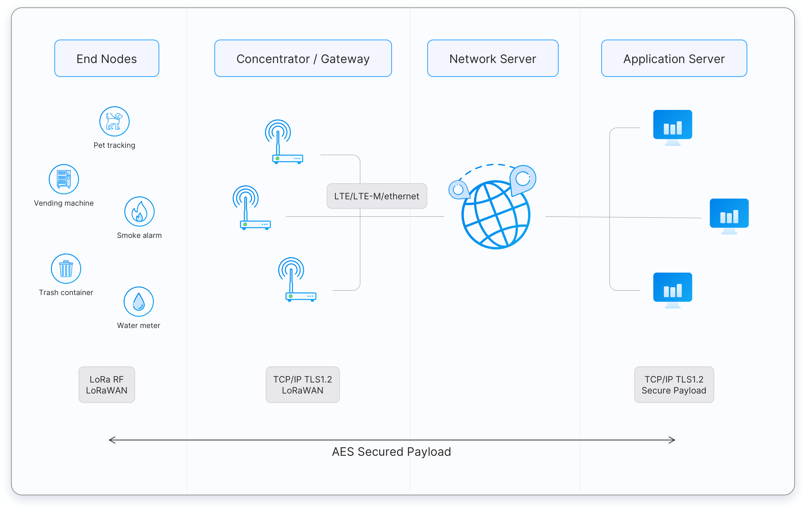


## Prerequisites 
1. You have created an account on AWS and have access to the AWS IoT Core Console. 
2. You have access to a LoRaWAN gateway which can transmit data to a network server.


## Configuring the LoRaWAN Gateway
In this example we use the [RAK WisGateOS 2](https://www.rakwireless.com/en-us/products/wisgate-os2) as our gateway.
In order to configure the gateway, follow these steps: 

1. Power up the Gateway
2. Connect to its WiFi. It should be called `Rak...`
   
   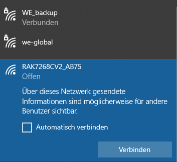

3. Access the Gateway through an internet browser of your choice on: `192.168.230.1`
   
   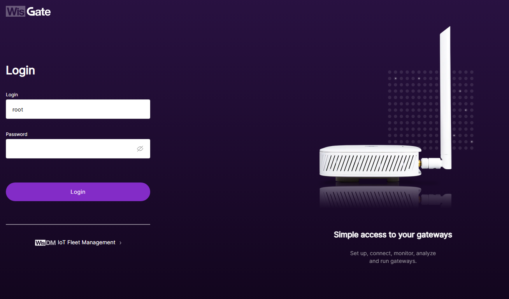

4. Use your login credentials. If you are logging in for the first time your credentials are 
   - `Username: root`
   - `Password: root`
   - Make sure to change these credentials after your initial login to ensure the security of your gateway. 
5. Connect the gateway to your (W)LAN. **Ensure you use a LAN without any proxy server settings.**

You are now ready to connect the AWS network server with your gateway. We recommend to [**watch this short video**](ttps://www.youtube.com/watch?v=1TBxHKXDfOA) by RAKWireless on how to connect the RAK WisGateOS 2 to AWS. If you prefer a more general documentation see the [official AWS documentation on how to onboard a LoRaWAN gateway](https://docs.aws.amazon.com/iot-wireless/latest/developerguide/lorawan-onboard-gateways.html). 

As an alternative to watching the official video, you can follow along here: 

6. Copy the unique `GatewayEUI` to your clipboard. The GatewayEUI can be found on the homescreen dashboard. 
   
   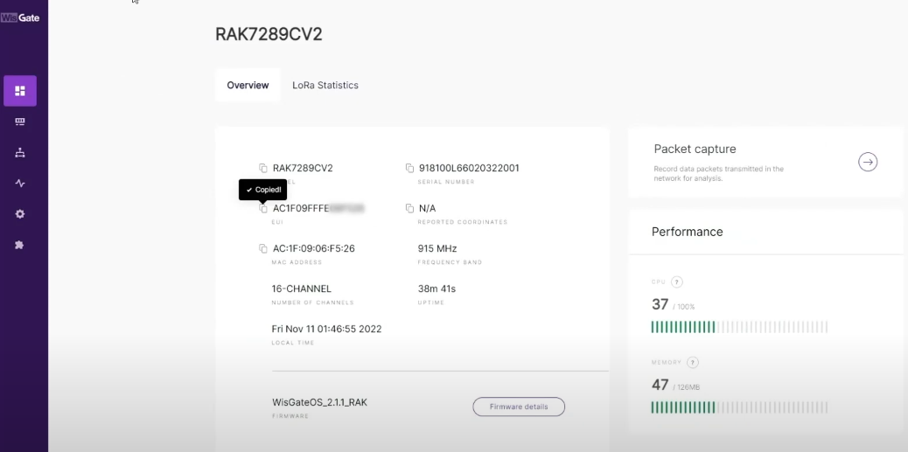

7. Navigate to the AWS iot Core Console, click on the tab `Gateways` and then `Add gateway`: 

   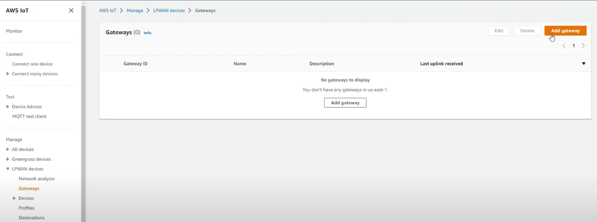

8. Paste the GatewayEUI into the corresponding field. Choose a name for the gateway and select the correct frequency band - if you are located in the EU, select `EU868` from the dropdown menu. 

   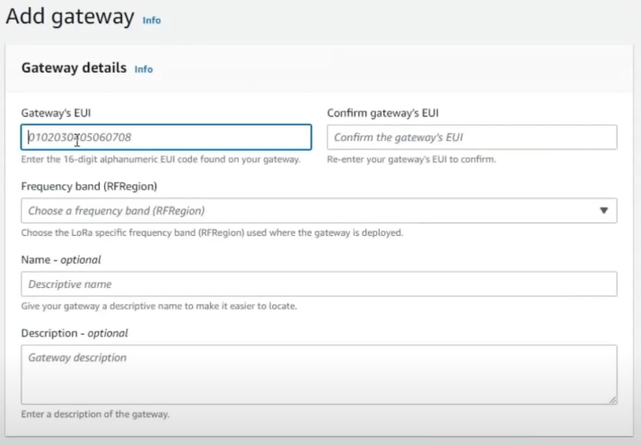

9. At the bottom of the page, check the box `Associate your gateway with an AWS IoT Core Thing` and choose the destination that should have automatically been created for you. 
10. Click on `Create gateway`. 
11. On the next page, first click on `Create Gateway Certificate`. Then, `download certificate files` and lastly `download server trust certificates`. 

      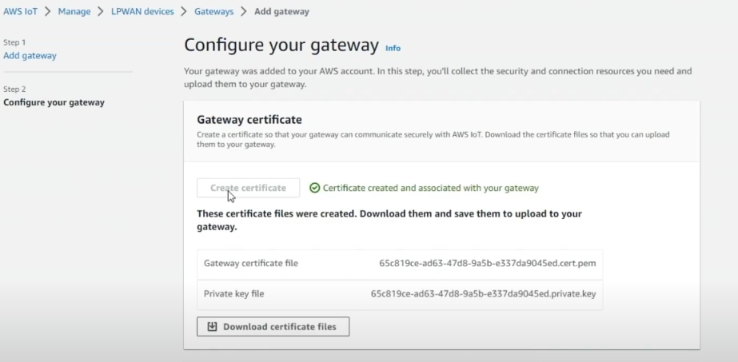

12. Now, you are supposed to choose the so-called `IoTWirelessGatewayCertManagerRole`. If you see the role, select the role from the dropdown (you can skip the next subsection). If the search results are empty, you don't have the necessary IAM role. **You must first `create` the IAM role before moving on**. For more information, see the [AWS documentation](https://docs.aws.amazon.com/iot-wireless/latest/developerguide/lorawan-rfregion-permissions.html).
    1.  In **Select type of trusted entity**, choose `Another AWS account`.
    2.  In **Account ID**, enter your AWS account ID, and then choose `Next: Permissions`.
    3.  In the **search box**, enter `AWSIoTWirelessGatewayCertManager`.
    4.  In the list of search results, select the policy named `AWSIoTWirelessGatewayCertManager`.
    5.  Choose `Next: Tags`, and then choose `Next: Review`.
    6.  In **Role name**, enter `IoTWirelessGatewayCertManagerRole`, and then choose `Create role`.
    7.  To edit the new role, in the confirmation message, choose `IoTWirelessGatewayCertManagerRole`.
    8.  In **Summary**, choose the `Trust relationships` tab, and then choose `Edit trust relationship`.
    9.  In **Policy Document**, change the `Principal` property to look like this example.
      ```json
         "Principal": { 
            "Service": "iotwireless.amazonaws.com" 
         },
      ```
      After you change the Principal property, the complete policy document should look like this example:
      ```json
         {
            "Version": "2012-10-17",
            "Statement": [
               {
                  "Effect": "Allow",
                  "Principal": {
                  "Service": "iotwireless.amazonaws.com"
                  },
                  "Action": "sts:AssumeRole",
                  "Condition": {}
               }
            ]
         }
      ```
    10. To save your changes and exit, choose `Update Trust Policy`.

      You’ve now created the `IoTWirelessGatewayCertManagerRole`. You won’t need to do this again. You can close this window and the IAM console and return to the AWS IoT console to finish adding the gateway.

13. Copy the CUPS and LNS endpoints and download certificates.   
    Your LoRaWAN gateway must connect to a CUPS or LNS endpoint when establishing a connection to AWS IoT Core for LoRaWAN. It is recommended to use the CUPS endpoint as it also provides configuration management. However, for the scope of this short tutorial, we will only configure the LNS endpoint as shown in [official Rakwireless tutorial](https://www.youtube.com/watch?v=1TBxHKXDfOA). 
    
14. Click the Copy button to copy the CUPS and LNS endpoints. You'll need this information later to configure your gateway. If not done already, click the `Download server trust certificates` button to download the trust certificates for the CUPS and LNS endpoints.
15. Again, switch to your gateway's wifi and log into the web interface as described in steps 2-4. There, navigate to the configuration tab (second from the top). Select the following settings. 
    * `Work Mode: Basic`
    * `Log Level: NOTICE` 
    * `Basic station server Setup->configure Basic station server setup: LNS Server` and select the setting as specified below. 
    * `Authentication Mode: TLS Server & Client Authentication`
    * Enter the LNS server URL: `wss://example12345.lns.lorawan.eu-central-1.amazonaws.com` on Port: `443`. You can copy your endpoint from your AWS console. **Make sure to delete the `:443` at the end of the address** and instead enter it in the `Port` field. 
         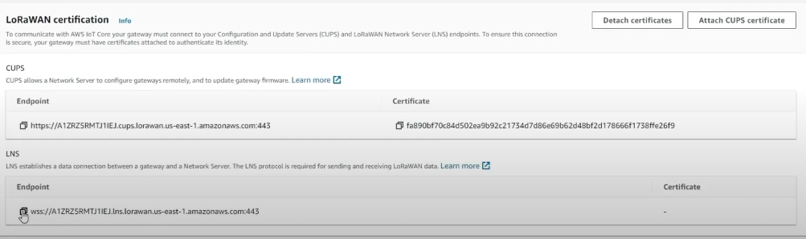
    * In the **trust certificate** field, upload the `lns.trust` file that you downloaded, previously. 
    * In the **client certificate** field, upload the `a1b2c3...pem.cert` file.
    * In the **client key** field, upload the  `a1b2c3...private.key` file. 

      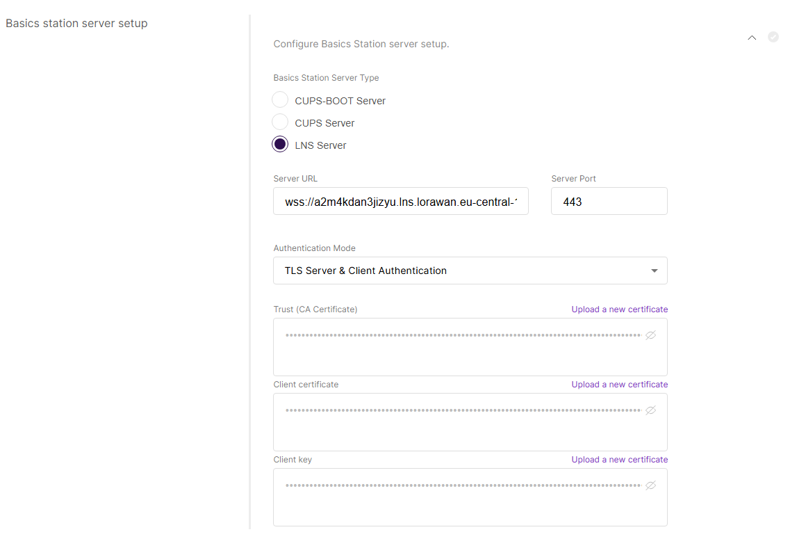

16. Click on `save changes` and head back to the AWS IoT Core console. Refresh the page and verify that the gateway has connected and an uplink has been received. 

<br>

## Further Resources
[1] AWS IoT Core LoRaWAN Documentation: https://docs.aws.amazon.com/iot-wireless/latest/developerguide/iot-lorawan.html   
[2] RAKwireless - Connect Your WisGateOS2 LoRaWAN Gateways To AWS IoT Core: https://www.youtube.com/watch?v=1TBxHKXDfOA  
[3] AWS IoT Core - Onboard Gateway: https://docs.aws.amazon.com/iot-wireless/latest/developerguide/lorawan-onboard-gateways.html   
[4] AWS IoT Core - Onboard Device: https://docs.aws.amazon.com/iot-wireless/latest/developerguide/lorawan-onboard-end-devices.html   
[5] AWS - Getting Started with AWS IoT Core for LoRaWAN: https://www.youtube.com/watch?v=6-ZrdRjqdTk 
<br>
<br>

# Registering the Daphnis-I FeatherWing as a Device on AWS

This section explains how to register your Daphnis-I FeatherWing with AWS IoT Core. It includes generating your own `AppEUI` and `AppKey`, required for secure device provisioning.

Follow these steps carefully to successfully onboard your LoRaWAN device to AWS IoT Core:

## Generate your own AppEUI and AppKey.
AWS IoT Core requires an `AppEUI` and an `AppKey` provided by the user (whereas on TTN you create them during setup). These keys can be generated directly **in your terminal**.    

**Generate an `AppEUI` (8 bytes hex)**   
Paste the following code in your terminal:
* if you are using windows (powershell):
   ```bash
   -join ((48..57) + (65..70) | Get-Random -Count 16 | ForEach-Object {[char]$_})
   ``` 
* in case you have openssl installed: 
   ```bash
   openssl rand -hex 8
   ```
* if you are using macOS/Ubuntu: 
   ```sh 
   xxd -l 8 -p /dev/urandom | tr -d '\n'
   ```
The output should look similar to this: 
   ```bash
      A3F6B7D9E21408C5
   ```
This is your `App/Join EUI`. Copy this to your clipboard and store it somewhere safe. You will need to paste this later on AWS and within the source code.   


**Generate an `AppKey` (16 bytes hex)**   
Paste the following code in your terminal:
* if you are using windows (powershell):
   ```bash
   -join ((48..57) + (65..70) | Get-Random -Count 32 | ForEach-Object {[char]$_})
   ```
* in case you have openssl installed: 
   ```bash
   openssl rand -hex 16
   ```
* if you are using macOS/Ubuntu:
   ```sh 
   xxd -l 16 -p /dev/urandom | tr -d '\n'
   ```
The output should look similar to this: 
   ```bash
      A3F6B7D9E21408C5A3F6B7D9E21408C5
   ```
This is your `AppKey`. Copy this to your cliboard and store it somewhere safe. You will need to paste this later on AWS and within the source code. 

<br>

## Onboarding your Device on AWS

### Steps to Onboard Your Wireless Device

Here is an overview on what steps you will have to complete for a successful setup. By following these steps, you can effectively integrate the Daphnis-I FeatherWing with AWS IoT Core, facilitating seamless communication between your Daphnis-I and your cloud-hosted applications.

1. **Add Your Wireless Device**: Register your device with AWS IoT Core for LoRaWAN. Detailed instructions are available at [Add your wireless device to AWS IoT Core for LoRaWAN](https://docs.aws.amazon.com/iot-wireless/latest/developerguide/lorawan-end-devices-add.html).

2. **Add Profiles**: Create or assign existing device and service profiles that match your device's configuration. For more details, see [Add profiles to AWS IoT Core for LoRaWAN](https://docs.aws.amazon.com/iot-wireless/latest/developerguide/lorawan-define-profiles.html).

3. **Add Destinations**: Set up destinations to process your device's messages and route them appropriately within AWS services. Guidance on this step is provided in [Add destinations to AWS IoT Core for LoRaWAN](https://docs.aws.amazon.com/iot-wireless/latest/developerguide/lorawan-destinations.html).

4. **Create Rules**: Develop AWS IoT rules to process LoRaWAN device messages, enabling actions based on the data received. Instructions can be found at [Create rules to process LoRaWAN device messages](https://docs.aws.amazon.com/iot-wireless/latest/developerguide/lorawan-rules.html).

5. **Connect and Verify**: Establish a connection between your LoRaWAN device and AWS IoT Core, then verify its connection status. For verification steps, see [Connect your LoRaWAN device and verify its connection status](https://docs.aws.amazon.com/iot-wireless/latest/developerguide/lorawan-connect-device.html).


**Note**: 
- For comprehensive details and the latest updates, refer to the official AWS documentation: [Onboard your devices to AWS IoT Core for LoRaWAN](https://docs.aws.amazon.com/iot-wireless/latest/developerguide/lorawan-onboard-end-devices.html).
- We also recommend to watch this [AWS YouTube tutorial](https://www.youtube.com/watch?v=6-ZrdRjqdTk). 


### Step 1: Adding your Wireless Device and creating a Profile with the Wireless Device Specification
Navigate to the AWS IoT Core for [LoRaWAN Intro page](https://console.aws.amazon.com/iot/home#/wireless/landing) of the AWS IoT console, choose `Get started`, and then choose `Add device`.   

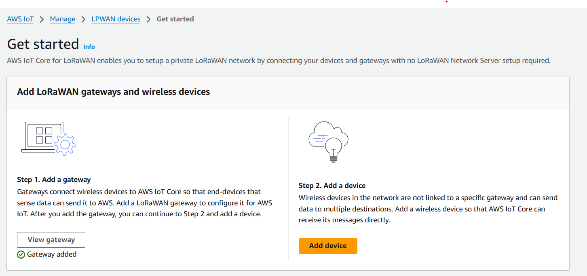


Firstly, you must specify a `Wireless device specification` based on your activation method. 
For this example, we use `OTAA` (over-the-air-activation). Hence, enter the following parameters: 
* Since we are using `LoRaWAN® version: 1.0.4.`, select `OTAA v1.0.x` as your `LoRaWAN version`
* Enter your `DevEUI`: use the default DevEUI that is provided by the vendor (this is unique to your device). If you do not know your device EUI <a href="../../README.md#Quick_start_example">see step 4 of our quick start guide</a>. 
* **Now, you are supposed to paste the previously created `AppKey` and the `App EUI` in the corresponding fields**. 
* Give your device a name

   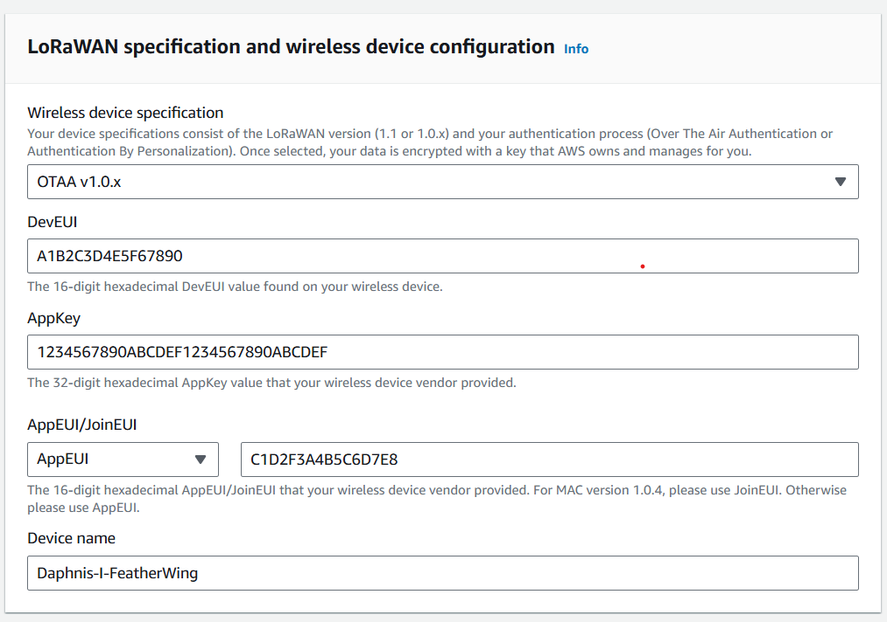

* Check the box `Associate a thing with your wireless device`, give it a name and then click on `Next`
  
  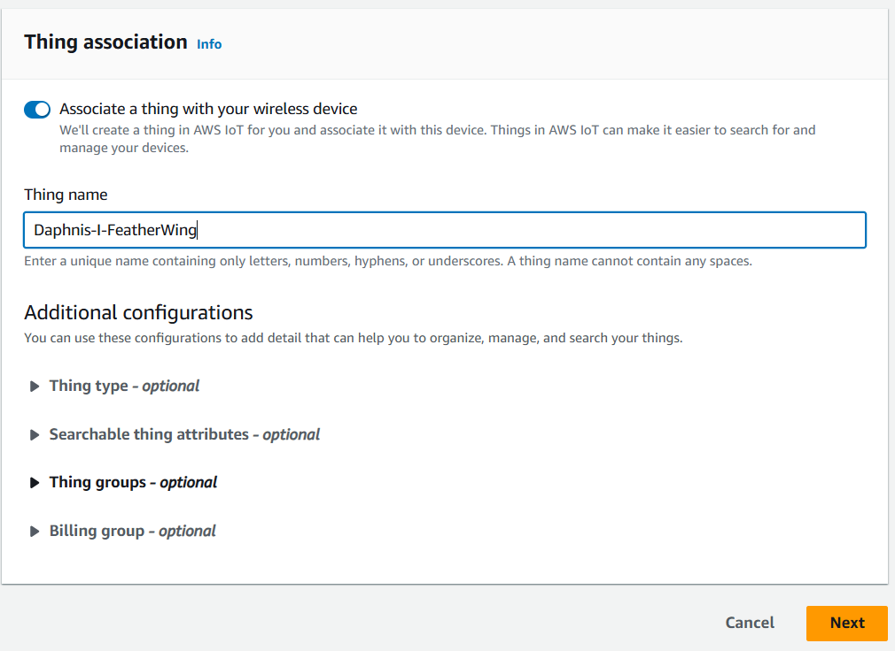


### Step 2: Create a Device Profile
Next, you must create a device profile. Device profiles define the device capabilities and boot parameters that the network server uses to set the LoRaWAN radio access service. It includes selection of parameters such as LoRa frequency band, LoRa regional parameters version, and MAC version of the device. Once selected, your data is encrypted with a key that AWS owns and manages for you. Create a new device profile: 
* If you are located in Europe, choose `EU868-A-OTAA` as your default profile from the dropdown menu
* We are using `Regional parameters Version: 2-1.0.1.` which corresponds to `RP002-1.0.1` on AWS
* The `MAC Version` should be `1.3` or `1.4` (once you select the default profile this value should already be preconfigured, you can leave it)
* As `MaxEIRP` you can for instance enter `15` or leave it at the default value
* Check the box `Supports Join`.

   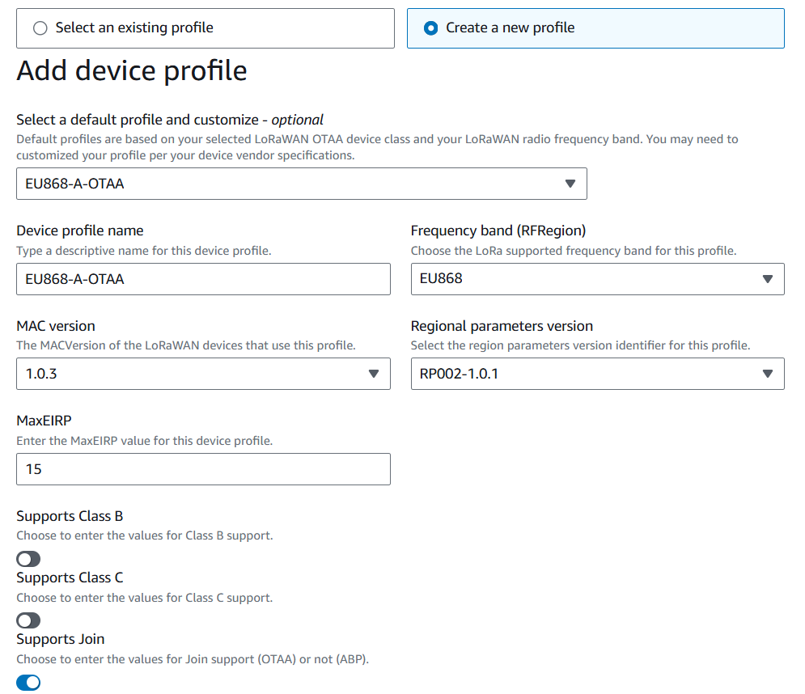


Leave the optional parameters like they were and click on `Next`.   

### Step 3: Create an AWS Destination 
Now, you must create a `Destination` which is done by entering a name for your destination. An AWS destination refers to a resource where data or events are sent for processing or storage. Once data is sent to a destination a rule is invoked to further process the data. 

### Step 4: Create an AWS Rule for further data processing 
Just below, you must enter a `Rule Name`, copy that name and click on `Create Rule`. 
   
   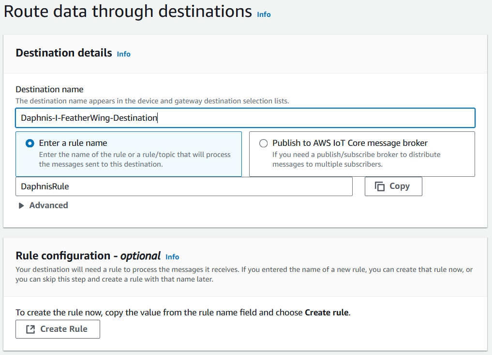

* In the new window, paste the name you have just copied such that the rule is properly linked. Then, click on `Next`. 

   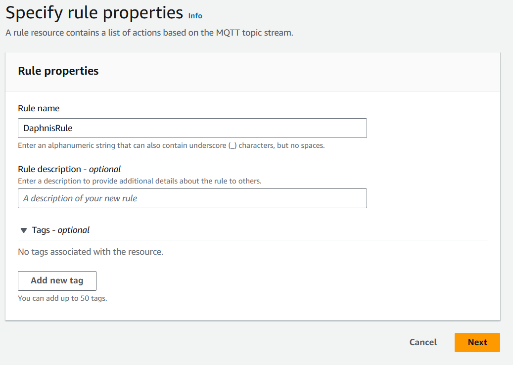

* Now, you are asked to provide an SQL statement. Paste the following SQL statement and click on `Next`: 
   ```sql
   SELECT * FROM 'lorawan/daphnis' 
   ```
   **Note:** `'lorawan/daphnis'` can also be replaced by `'iot/daphnis'` or just `'daphis'` or `'any/other/topic/you/wish'` as shown in the image below. It specifies under which MQTT topic forwarded messages will appear. 

   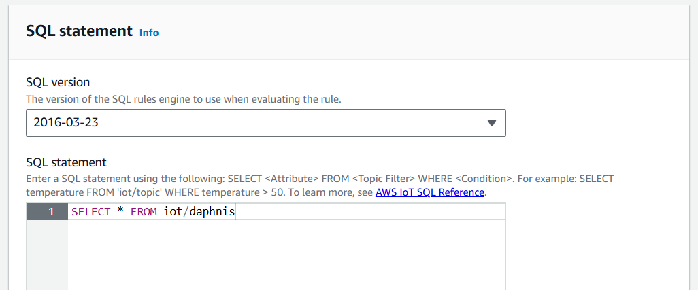

* In the next window, you must choose one or more `Rule actions`. We will configure two actions: 
  1. An action that just forwards the  metadata and the raw (encoded) payload to an MQTT topic on AWS. 
      **Please note that it is sufficient to just implement the first action and skip the second action for now**.
  2. An action that decodes the payload byte array into a JSON format and republishes that JSON to an MQTT topic on AWS. Currently, the payload that is sent via LoRa is still in byte format. To be of any use, the payload must be deserialized/decoded. To format the payload on AWS, you can use a Lambda function. Lambda functions allow you to process data going to and from end devices, converting binary payloads to human-readable fields or performing many other tasks not covered in this setup guide. In the following, it is shown how the byte-array payload can be formatted to JSON which can be further used upstream. 
  **Current structure of the serialized sensor data payload:**

      | Byte Index | Sensor Value          | Description                      |
      | ---------- | --------------------- | -------------------------------- |
      | 0-3        | `PADS_pressure`       | Pressure sensor value (float)    |
      | 4-7        | `PADS_temp`           | Temperature sensor value (float) |
      | 8-11       | `ITDS_accelX`         | Accelerometer X-axis (float)     |
      | 12-15      | `ITDS_accelY`         | Accelerometer Y-axis (float)     |
      | 16-19      | `ITDS_accelZ`         | Accelerometer Z-axis (float)     |
      | 20-23      | `ITDS_temp`           | Temperature sensor value (float) |
      | 24         | `ITDS_doubleTapEvent` | Double tap event (boolean)       |
      | 25         | `ITDS_freeFallEvent`  | Free fall event (boolean)        |
      | 26-29      | `TIDS_temp`           | Temperature sensor value (float) |
      | 30-33      | `HIDS_humidity`       | Humidity sensor value (float)    |
      | 34-37      | `HIDS_temp`           | Temperature sensor value (float) |

      We will format the payload to look like this: 

      ```json
      {
      "data": {
         "PADS_pressure": 1013.25,
         "PADS_temp": 22.5,
         "ITDS_accelX": 0.01,
         "ITDS_accelY": -0.02,
         "ITDS_accelZ": 0.98,
         "ITDS_temp": 25.0,
         "ITDS_doubleTapEvent": true,
         "ITDS_freeFallEvent": false,
         "TIDS_temp": 23.0,
         "HIDS_humidity": 45.0,
         "HIDS_temp": 21.5
      },
      "warnings": [],
      "errors": []
      }
      ``` 
* For action 1: 
  * Select `Republish to AWS IoT topic` as your action 
  * Give your topic a name
  * QoS is 0
  
      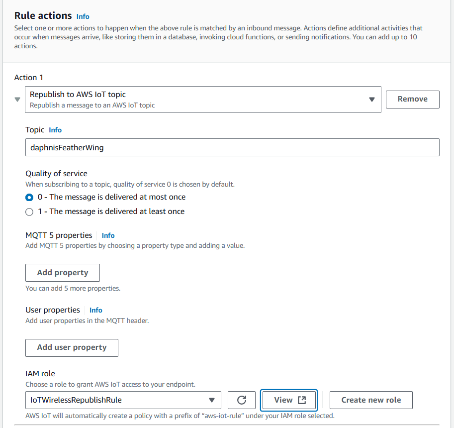

  * Create an `IAM Role`. To do this, simply click on `Create new Role` and give it a name. The role with the necessary permissions should be automatically created. 

      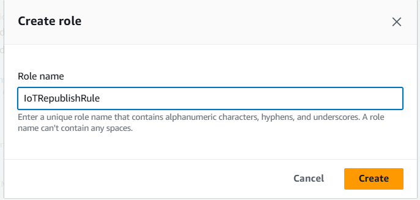

* For action 2: 
  * Click on `Add rule section`
  * Select `Lambda` from the dropdown menu 
  * `Create a Lambda Function`

      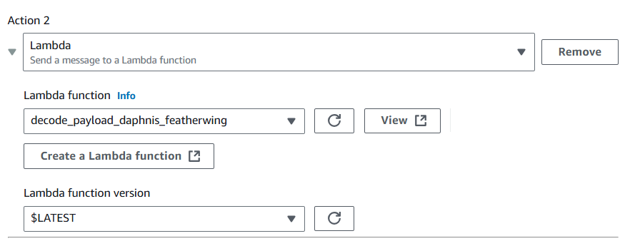

  * In the creation window, select `author function from scratch`, give it a name and choose `python 3.13` as the runtime and `x86` architecture.
  * While it reasonable to give the function the permission to publish to an IoT topic on AWS directly, the role necessary for that has not been created yet and thus cannot be selected now, so just select the role with `basic permissions` option. Click on `create function`. 
  
      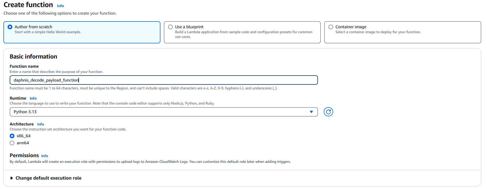

  * In the new function overview window, complete the following steps: 
    * Select `AWS IoT` as a trigger for the lambda function 
  
       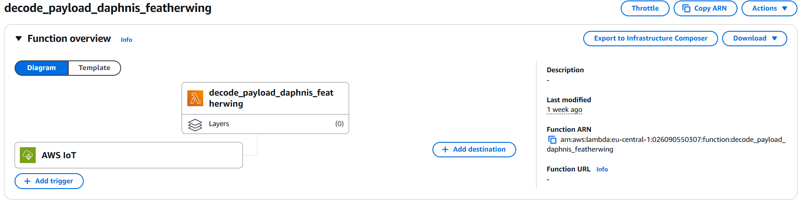

    * Paste the following code in the code editor and then click on `deploy code`
      ```python
      import base64
      import struct
      import json
      import boto3

      def lambda_handler(event, context):
         try:
            payload_input = event.get('PayloadData', '')  # Extract the payload data from the event
            if isinstance(payload_input, bytes):
                  payload_input = payload_input.decode('utf-8')  # Decode from bytes to string if necessary
            if not isinstance(payload_input, str):
                  raise ValueError("PayloadData must be a base64-coded string.")  # Ensure the payload is a string

            payload = base64.b64decode(payload_input)  # Decode the base64 encoded payload
            if isinstance(payload, str):
                  payload = payload.encode('utf-8')  # Ensure the payload is in bytes

            index = 0
            formatted_data = {}  # Dictionary to hold formatted data

            def read_float(payload, index):
                  if len(payload) < index + 4:
                     raise ValueError(f"Not enough data to read a float at index {index}.")  # Check for sufficient data
                  value = struct.unpack('f', payload[index:index+4])[0]  # Unpack the 4-byte float value
                  return value, index + 4  # Return the value and update the index

            formatted_data['PADS_pressure'], index = read_float(payload, index)  # Read pressure data
            formatted_data['PADS_temp'], index = read_float(payload, index)  # Read temperature data
            formatted_data['ITDS_accelX'], index = read_float(payload, index)  # Read X-axis acceleration data
            formatted_data['ITDS_accelY'], index = read_float(payload, index)  # Read Y-axis acceleration data
            formatted_data['ITDS_accelZ'], index = read_float(payload, index)  # Read Z-axis acceleration data
            formatted_data['ITDS_temp'], index = read_float(payload, index)  # Read temperature data for ITDS

            if len(payload) > index:
                  formatted_data['ITDS_doubleTapEvent'] = struct.unpack_from('B', payload, index)[0] == 1  # Read double-tap event
                  index += 1
            else:
                  raise ValueError("Not enough data to read ITDS_doubleTapEvent.")  # Check if data is sufficient

            if len(payload) > index:
                  formatted_data['ITDS_freeFallEvent'] = struct.unpack_from('B', payload, index)[0] == 1  # Read free-fall event
                  index += 1
            else:
                  raise ValueError("Not enough data to read ITDS_freeFallEvent.")  # Check if data is sufficient

            formatted_data['TIDS_temp'], index = read_float(payload, index)  # Read temperature data for TIDS
            formatted_data['HIDS_humidity'], index = read_float(payload, index)  # Read humidity data
            formatted_data['HIDS_temp'], index = read_float(payload, index)  # Read temperature data for HIDS

            # Create the IoT Data client (make sure the IAM role has the iot:Publish permission)
            iot_data_client = boto3.client('iot-data', region_name='eu-central-1')  # e.g., "eu-central-1"

            # Publish the processed data to the target MQTT topic
            iot_data_client.publish(
                  topic='lorawan/daphnis/decoded',  # e.g., "sensors/updated"
                  qos=0,
                  payload=json.dumps(formatted_data, indent=4)  # Send the formatted data as a JSON payload
            )

            return {
                  'statusCode': 200,  # Return success status
                  'body': json.dumps(formatted_data, indent=4)  # Return the formatted data in the response body
            }

         except (ValueError, struct.error) as e:  # Catch ValueError and struct errors
            return {
                  'statusCode': 400,  # Return error status if there's an issue
                  'body': json.dumps({"error": str(e)})  # Return the error message
            }

      ```
     * Now, you can head back to the page where you have attached the action. 
   * Click on `Next`. Review the rule and click on `create`. 
   * Finally, head back to the 'add device' page from where you linked the rule. 
   * At the bottom of that page you must attach a role with the right permission. `Create a new service role` and give it a name. AWS will automatically create the role with the necessary permissions. 

      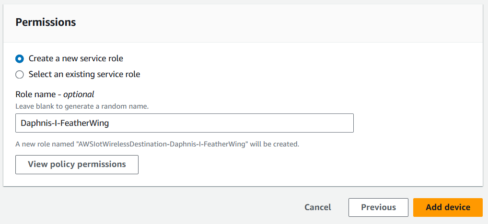

   * Click on `Add Device`, if everything was done correctly it should show a success message and direct you to the device page. 
   
#### Step 4.1: Give Lambda Function`s Execution Role Necessary Permission
* Navigate to your newly created lambda function. On the function overview page, navigate to the tab `Configuration->Permissions` and click on the link of the `Execution Role`. 
* On the overview page of the execution role, in the `Permissions` tab, click on `Add permissions` and choose `Create inline Policy`
  
   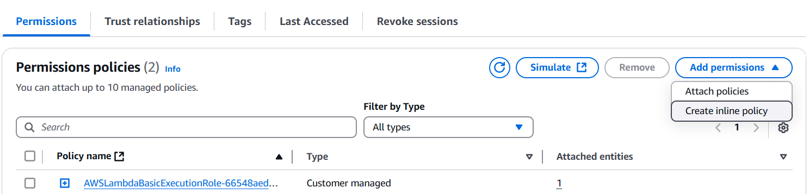

* Select the `JSON` option instead of the `Visual` option and paste the following code in the JSON window: 
   ```json
   {
   "Version": "2012-10-17",
   "Statement": [
      {
         "Effect": "Allow",
         "Action": "iot:Publish",
         "Resource": "*"
      }
   ]
   }
   ```
   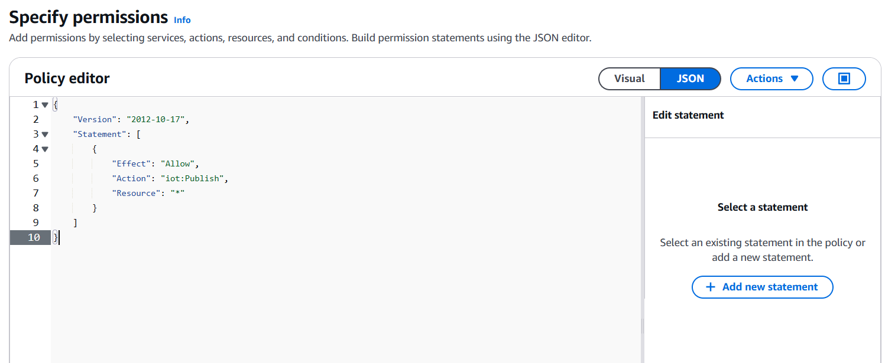

* Click on `next`. Afterwards, choose a name and click on `Create policy`. 

   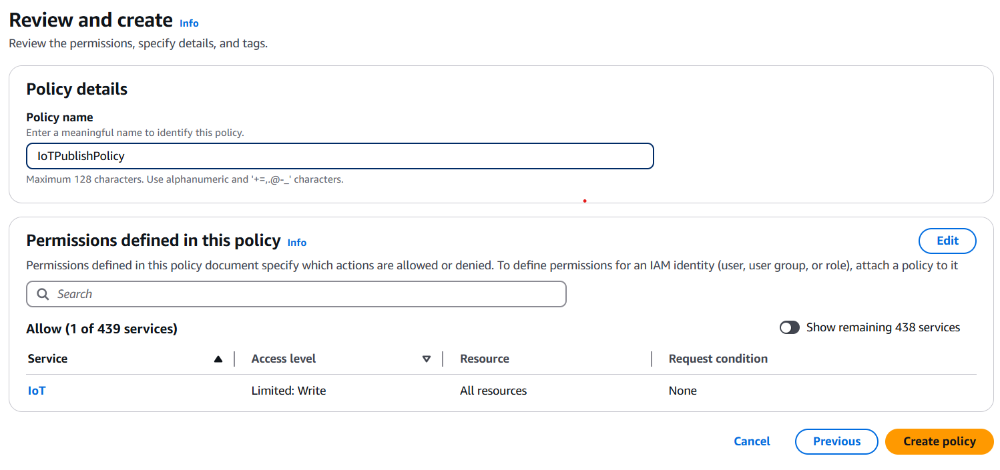

* Your lambda function's execution role should now have the necessary permissions to publish MQTT messages. 


### Step 5: Connect the Device
* After the device has been registered at AWS, it can join the network. **However, you must set the `AppEUI` and the `AppKey` in the source code first**. [See step 2 of our quick start guide](../../README.md#quick_start_example) on how and where to set these values. 
* The AppKey and AppEUI were created [in this section](#generate-your-own-appeui-and-appkey-key).
* Once you have set these values, you are ready to compile and flash the m-zero FeatherWing ([see this section on how to do this](../../README.md#running-the-example)). 
* After a successful join, navigate to the `things` page under `Manage -> All devices` and view your newly created device there. Navigate to the `Activity` tab in your device overview and click on `view mqtt client`. There, you subscribe to the `#` topic to check for incoming messages from your device. Later, you can subscribe to a more specific topic. Subscribing to `#` ensures you receive all incoming messages and do not miss any due to some syntax/spelling error. You should now see two new messages every 60 seconds: 
  * A message with Daphnis-I metadata and encoded payload 
  * A message with just decoded payload in JSON format 

   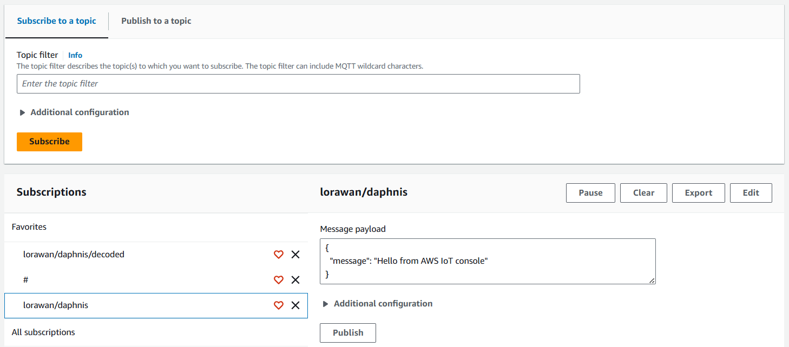

### Further Resources: 
[1] AWS IoT Core - Onboard Device: https://docs.aws.amazon.com/iot-wireless/latest/developerguide/lorawan-onboard-end-devices.html      
[2] AWS IoT Core Lambda Rules: https://docs.aws.amazon.com/iot/latest/developerguide/lambda-rule-action.html
