**Table of Contents:**

- [Introduction](#introduction)
- [Configuring the LoRaWAN Gateway](#configuring-the-lorawan-gateway)
  - [How LoRaWAN Communication Works](#how-lorawan-communication-works)
  - [Prerequisites](#prerequisites)
  - [Configuring the LoRaWAN Gateway](#configuring-the-lorawan-gateway-1)
- [Connecting your device with TTN via the Gateway](#connecting-your-device-with-ttn-via-the-gateway)
  - [Prerequisites for registering a device](#prerequisites-for-registering-a-device)
  - [Add Device on TTN](#add-device-on-ttn)
  - [Further Ressources](#further-resources)
- [Data Processing on TTN](#data-processing-on-ttn)
  - [Deserialize the payload and transform into JSON format](#deserialize-the-payload-and-transform-into-json-format)
      - [Current structure of the serialized sensor data payload](#current-structure-of-the-serialized-sensor-data-payload)
      - [Example JSON](#example-json)
      - [Javascript Decoder Function](#javascript-decoder-function)
      - [Further Ressources](#further-resources-1)
  - [Forward the formatted data via MQTT and view it in MQTT Terminal](#forward-the-formatted-data-via-mqtt-and-view-it-in-mqtt-terminal)
    - [Step 1: Create a Key on TTN](#step-1-create-a-key-on-ttn)
    - [Step 2: Install an MQTT Broker](#step-2-install-an-mqtt-broker)
      - [Using Mosquitto](#using-mosquitto)
      - [Using MQTT Explorer](#using-mqtt-explorer)
- [Configuring TTN with AWS](#configuring-ttn-with-aws)
  - [Features of integrating via TTN](#features-of-integrating-via-ttn)
  - [Prerequisites](#prerequisites-1)
  - [AWS Deployment Guide](#aws-deployment-guide)
  - [Further Resources](#further-resources-2)
- [Configuring TTN with Microsoft Azure IoT Hub](#configuring-ttn-with-microsoft-azure-iot-hub)
  - [Features of integrating via TTN](#features-of-integrating-via-ttn-1)
  - [Prerequisites](#prerequisites-2)
  - [Azure IoT Hub Deployment Guide](#azure-iot-hub-deployment-guide)
  - [Further Resources](#further-resources-3)
- [Configuring TTN with KaaIoT](#configuring-ttn-with-kaaiot)
  - [Features of integrating via TTN](#features-of-integrating-via-ttn-2)
  - [Prerequisites](#prerequisites-3)
  - [KaaIoT Deployment Guide](#kaaiot-deployment-guide)
  - [Further Resources](#further-resources-4)

<br>
<br>

# Introduction

In this guide, we will walk you through the process of configuring your LoRaWAN gateway and connecting it to [The Things Network (TTN)](https://www.thethingsnetwork.org/). There are two main components to this setup: 
1. Configuring the gateway to communicate with the network server (TTN).
2. Configuring the network server (TTN) to work with the Daphnis-I-FeatherWing: 
   - creating an application on TTN and 
   - managing devices (e.g., the Daphnis-I-FeatherWing) inside that application.   

Understanding how communication in the LoRaWAN network works, including the protocols used and the flow of data, is helpful for a successful setup.


# Configuring the LoRaWAN Gateway

## How LoRaWAN Communication Works

LoRaWAN (Long Range Wide Area Network) is a communication protocol designed for low-power, long-range communication between IoT devices. It operates in unlicensed ISM bands and uses a star-of-stars topology. A star-of-stars topology is a network configuration where multiple star networks are interconnected. In a star network, each device is connected to a central hub. In a star-of-stars topology, these hubs are further connected to a central core network, creating a hierarchical structure.
The main components of a LoRaWAN network include:

1. **End Devices**: These are sensors or actuators that send and receive data packets wirelessly using LoRa modulation.
2. **Gateways**: These devices receive messages/data packets from end devices and forward them to the network server.
3. **LoRaWAN Network Server (LNS)**: This server processes the data, removes duplicates, and ensures security.
4. **Application Server**: This server processes the application data and provides it to the end-user applications.

LoRaWAN uses an ALOHA-based protocol, meaning end devices do not need to peer with specific gateways. Instead, messages sent from end devices are received by all gateways within range, and the network server handles the rest. 


## Prerequisites 
1. You have created an account on The Things Network and have access to the TTN console. 
2. You have access to a LoRaWan gateway which can transmit data to a network server.


## Configuring the LoRaWAN Gateway
For this example we use the [RAK WisGateOS 2](https://www.rakwireless.com/en-us/products/wisgate-os2) as our gateway.
In order to configure the gateway, follow these steps: 

1. Power up the Gateway
2. Connect to its WiFi. It should be called `Rak...`
   
   

3. Access the Gateway through an internet browser of your choice on: `192.168.230.1`
   
   

4. Use your login credentials. If you are logging in for the first time your credentials are 
   - `Username: root`
   - `Password: root`
   - Make sure to change these credentials after your initial login to ensure the security of your gateway. 
5. Connect the gateway to your (W)LAN. **Ensure you use a LAN without any proxy server settings.**

You are now ready to connect the TTN network server with your gateway. We recommend to [**watch this short video**](https://www.youtube.com/watch?v=iWzwzKDoa2g) by RAKWireless on how to connect the RAK WisGateOS 2 to TTN via CUPS - Configuration and Update Server. CUPS is a component used to manage and update gateways remotely. CUPS allows for the configuration of gateways, firmware updates, and other management tasks without requiring physical access to the gateway. 

As an alternative to watching the official video, you can follow along here: 

6. Copy the unique `GatewayEUI` to your clipboard. The GatewayEUI can be found on the homescreen dashboard. 

   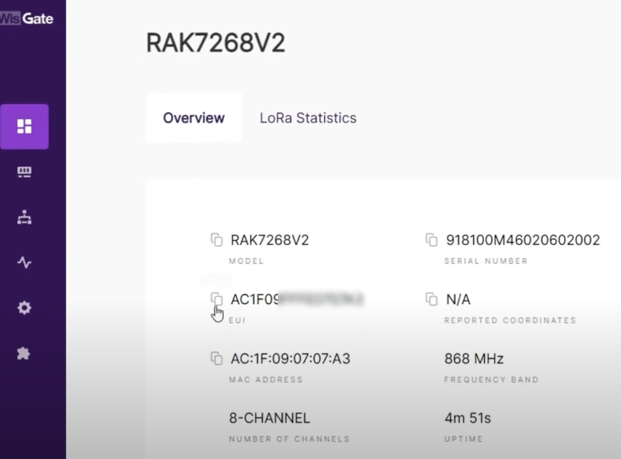

7. Navigate to the [TTN Console](https://console.cloud.thethings.network/), select your region and click on register gateway: 

   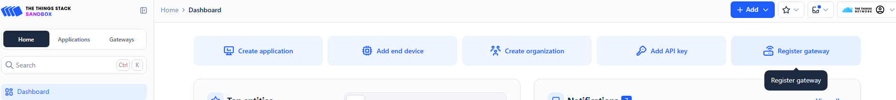

8. Paste the previously copied `GatewayEUI` into the required field. If you are located in Europe, select the frequency plan as specified below and assign the gateway a name of your choice: 

   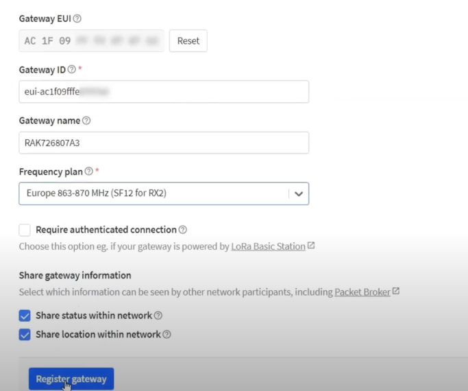

9. After registering, navigate to the `API keys` tab in the gateway menu and click on `Create API key`. 

   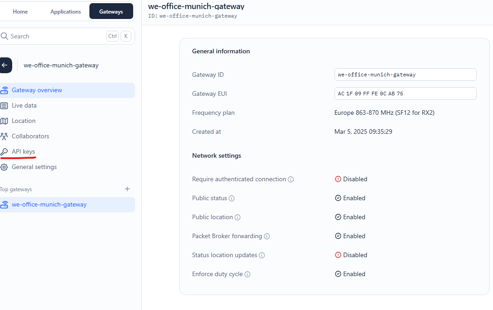

 
10. Create an LNS Key with the following permissions: 
   
   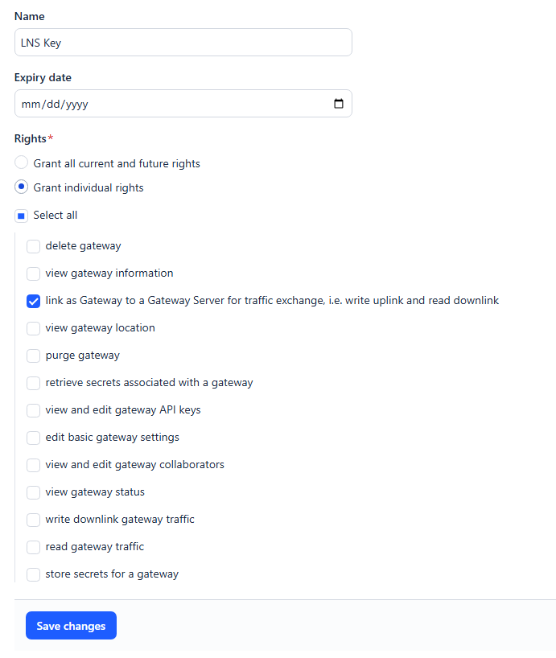

11. Save the key in a secure location. 

   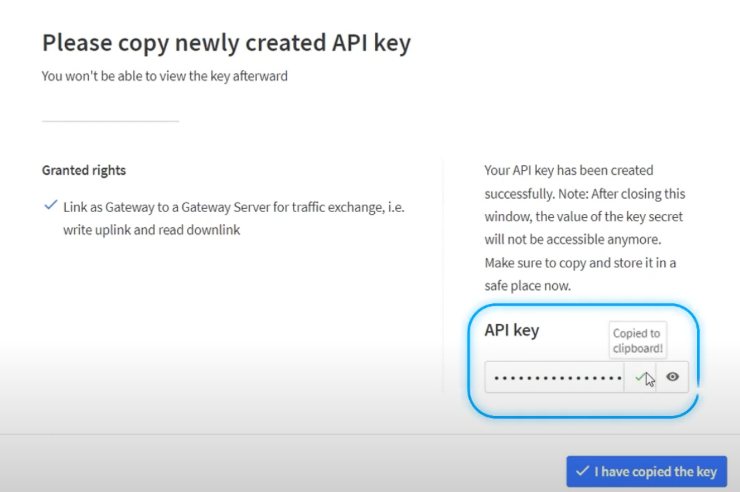

12. In the console, navigate to the `General settings` tab of your gateway and paste the LNS Key in the required field and click `save`. 

   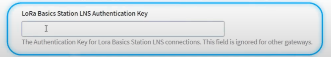

13. Then, navigate to the `API keys` tab and create a second key - the CUPS key. Ensure you copy the key somewhere safe. 

   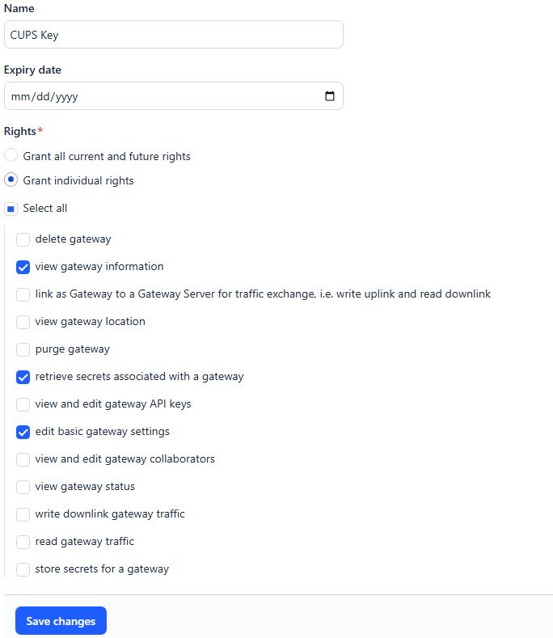

14. Again, switch to your gateway's wifi and log into the web interface as described in steps 2-4. There, navigate to the configuration tab (second from the top). Select the following settings. 
    * `Work Mode: Basic`
    * `Log Level: NOTICE` 
    * `Basic station server Setup->configure Basics station server setup: CUPS Server` and select the setting as specified below. 
    * `Authentication Mode: TLS Server & Client Token Authentication`
    * Paste the **CUPS Key** in the `Client Token` field 
    * Enter TTN's server URL: `https://eu1.cloud.thethings.network` on Port: `443` 

   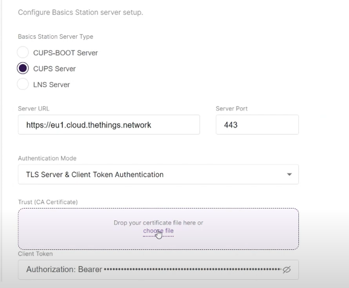

15. Now, [**click this link to download a pem certificate**](https://www.youtube.com/redirect?event=video_description&redir_token=QUFFLUhqbXB0bHhvODlJd25uTktLSFVtdWYtcWVUWlRFQXxBQ3Jtc0trd0Q3VzM4eDlyMEJIZUNqRU9fUzlHdjJzNUFibkhxWWFscUZCY3h0YS1LSVNkci1JVkU2VUJXZ2FWSThKM0Y1dk1iYUUwVFFLeVktdUwzbk1LN0RtckljT2VlQVRUQ3NqQmE4UndKUW9DMHhfNXVBWQ&q=https%3A%2F%2Fletsencrypt.org%2Fcerts%2Fisrgrootx1.pem&v=iWzwzKDoa2g). It should download the file, directly. Click on `Choose File` and select the prem certificate from your downloads. Then save this configuration. 

   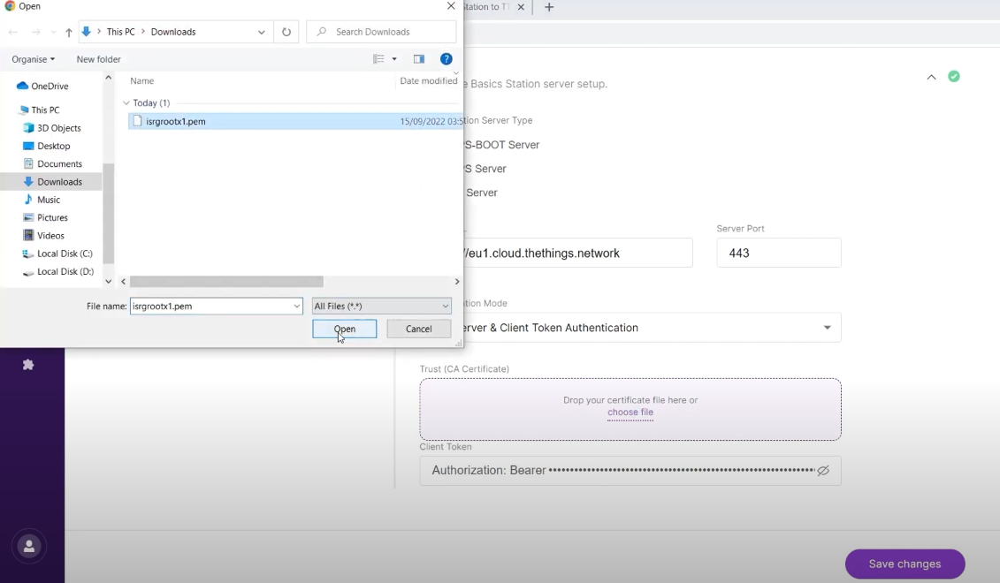

16. Navigate to the TTN gateway console. You should now be able to see that the gateway has connected successfully with TTN. 

   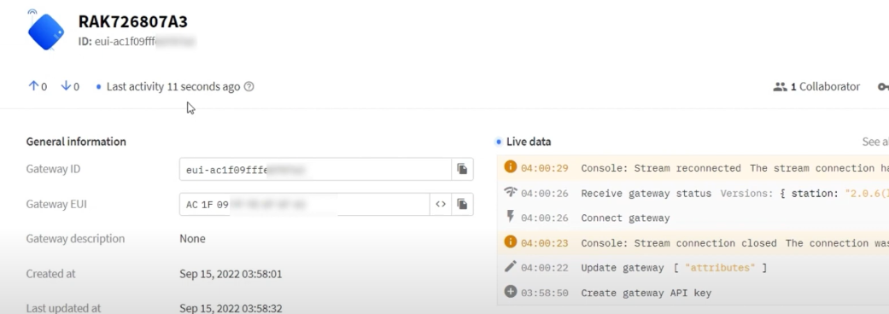

<br>
<br>

# Connecting your device with TTN via the Gateway 

## Prerequisites for registering a device 
1. You should have visited The Things Network website and created an account.
2. Successful registration of your Gateway
   * You should have ensured your gateway is connected to the internet and configured to communicate with TTN.
   * You should have followed the specific instructions for your gateway model to complete the setup.

## Add Device on TTN 
1. In the TTN Console, navigate to `Applications` and create a new application. 
2. Enter the end device specifications manually and choose the options as specified below:
   * `Frequency plan: Europe 863-870 MHz`
   * `LoRaWAN® version: 1.0.4.`
   * `Regional parameters Version: 2-1.0.1.`

   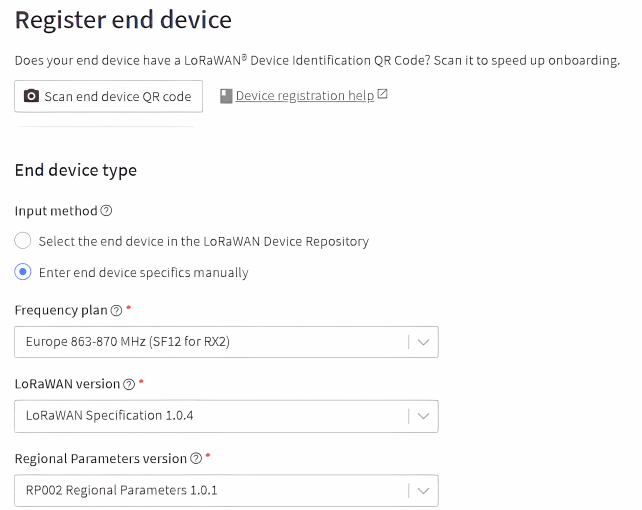

3. Choose your preferred activation mode. We highly recommend using the OTAA (Over-the-air-activation): 

   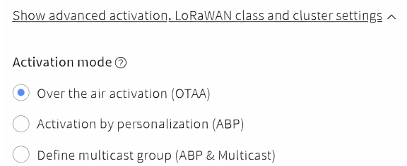

4. After Selecting `OTAA`, fill out the following fields. 
   * For now, set the `JoinEUI/AppEUI` to just 0s (later you can generate a non-zero AppEUI)
   * `DevEUI`: use the default DevEUI that is provided by the vendor (this is unique to your device). If you do not know your device EUI [see step 4 of our quick start guide](../../README.md#quick_start_example).
   * `AppKey`: generate a random key and save it (you will have to paste it in the source code later)
   * Register your end device

   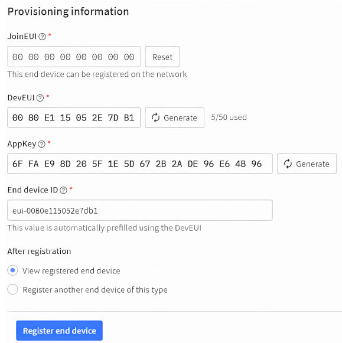

5. For using OTAA during development the following option can be used so that the DevNonce on the network server resets each time on join. In LoRaWAN, the DevNonce is a unique, 2-byte value generated by the end device, starting at 0 when the device is initially powered up and incremented with each join-request to prevent replay attacks. The Network Server uses the DevNonce of each end-device to keep track of their join requests.

   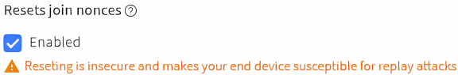


6. After the device has been registered at the network server, it can join the network. **However, you must set the App/Join EUI and the AppKey in the source code first**. [See step 2 of our quick start guide](../../README.md#quick_start_example) on how and where to set these values. 

By following these steps, you will have successfully configured your LoRaWAN gateway and connected it to TTN, enabling efficient and secure communication for your Daphnis-I FeatherWing. 


## Further Resources

[1] RAK Wireless - Connect your RAK Indoor & Outdoor LoRaWAN Gateway with WisGateOS 2 to TTN via the CUPS server: https://www.youtube.com/watch?v=iWzwzKDoa2g   
[2] RAK Wireless - Quickstart Guide for WisGate Edge Lite 2: https://docs.rakwireless.com/product-categories/wisgate/rak7268v2/quickstart/    
[3] WE Online - User Manual Daphnis-I: https://www.we-online.com/components/products/manual/2618011181000_UM_Daphnis-I_2618011181000_V1_0_rev1.1.pdf


<br>
<br>

# Data Processing on TTN 
Currently, the payload that is sent via LoRa is still in byte format. To be of any use, the payload must be deserialized/decoded.
To format the payload on The Things Network (TTN), you can use payload formatters. Payload formatters allow you to process data going to and from end devices, converting binary payloads to human-readable fields or performing other data conversions on uplinks and downlinks.   
In the following, it is shown how the byte-array payload can be formatted to JSON which can be further used upstream. 


## Deserialize the payload and transform into JSON format

#### Current structure of the serialized sensor data payload 

| Byte Index | Sensor Value          | Description                      |
| ---------- | --------------------- | -------------------------------- |
| 0-3        | `PADS_pressure`       | Pressure sensor value (float)    |
| 4-7        | `PADS_temp`           | Temperature sensor value (float) |
| 8-11       | `ITDS_accelX`         | Accelerometer X-axis (float)     |
| 12-15      | `ITDS_accelY`         | Accelerometer Y-axis (float)     |
| 16-19      | `ITDS_accelZ`         | Accelerometer Z-axis (float)     |
| 20-23      | `ITDS_temp`           | Temperature sensor value (float) |
| 24         | `ITDS_doubleTapEvent` | Double tap event (boolean)       |
| 25         | `ITDS_freeFallEvent`  | Free fall event (boolean)        |
| 26-29      | `TIDS_temp`           | Temperature sensor value (float) |
| 30-33      | `HIDS_humidity`       | Humidity sensor value (float)    |
| 34-37      | `HIDS_temp`           | Temperature sensor value (float) |

We will format the payload to look like this: 

#### Example JSON

```json
{
  "data": {
    "PADS_pressure": 1013.25,
    "PADS_temp": 22.5,
    "ITDS_accelX": 0.01,
    "ITDS_accelY": -0.02,
    "ITDS_accelZ": 0.98,
    "ITDS_temp": 25.0,
    "ITDS_doubleTapEvent": true,
    "ITDS_freeFallEvent": false,
    "TIDS_temp": 23.0,
    "HIDS_humidity": 45.0,
    "HIDS_temp": 21.5
  },
  "warnings": [],
  "errors": []
}
```

Navigate to your device inside the TTN console. There, click on the tab `Payload Formatters` and select `Uplink`. In the dropdown menu, select `Custom Javascript Formatter`.

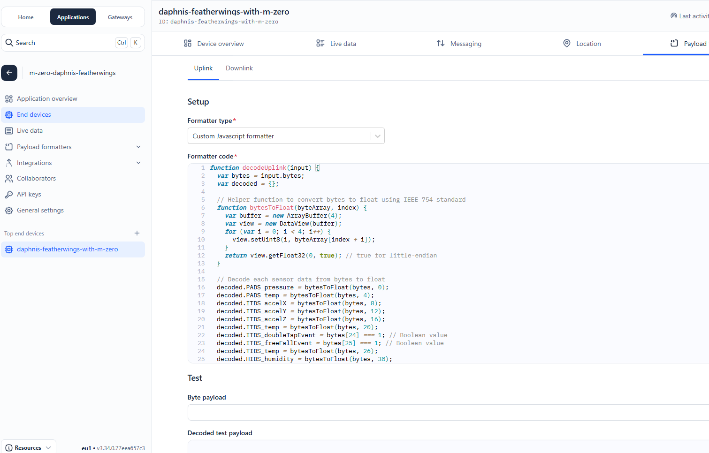

Paste the following code in the `Formatter code` box below: 

#### Javascript Decoder Function
```Javascript
function decodeUplink(input) {
  var bytes = input.bytes;
  var decoded = {};

  // Helper function to convert bytes to float using IEEE 754 standard
  function bytesToFloat(byteArray, index) {
    var buffer = new ArrayBuffer(4);
    var view = new DataView(buffer);
    for (var i = 0; i < 4; i++) {
      view.setUint8(i, byteArray[index + i]);
    }
    return view.getFloat32(0, true); // true for little-endian
  }

  // Decode each sensor data from bytes to float
  decoded.PADS_pressure = bytesToFloat(bytes, 0);
  decoded.PADS_temp = bytesToFloat(bytes, 4);
  decoded.ITDS_accelX = bytesToFloat(bytes, 8);
  decoded.ITDS_accelY = bytesToFloat(bytes, 12);
  decoded.ITDS_accelZ = bytesToFloat(bytes, 16);
  decoded.ITDS_temp = bytesToFloat(bytes, 20);
  decoded.ITDS_doubleTapEvent = bytes[24] === 1; // Boolean value
  decoded.ITDS_freeFallEvent = bytes[25] === 1; // Boolean value
  decoded.TIDS_temp = bytesToFloat(bytes, 26);
  decoded.HIDS_humidity = bytesToFloat(bytes, 30);
  decoded.HIDS_temp = bytesToFloat(bytes, 34);

  return {
    data: decoded,
    warnings: [],
    errors: []
  };
}
```
Save the payload formatting options.  
On TTN, there is also the option to test your function with real data (just copy one of the byte arrays from the data console and paste it into the corresponding field) and modify the function according to your needs. 
If done correctly, the data console should display your sensor data in Json-format instead of the raw byte array:

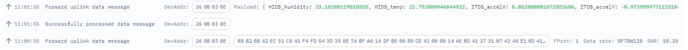


#### Further Resources
[1] https://www.thethingsindustries.com/docs/integrations/payload-formatters/    
[2] https://www.thethingsindustries.com/docs/integrations/payload-formatters/javascript/uplink/    
[3] https://youtu.be/4tii7MiD-yM

<br>
<br>

## Forward the formatted data via MQTT and view it in MQTT Terminal
The Things Stack exposes an MQTT server to work with streaming events. This section explains how to connect an MQTT client and subscribe to uplinks or publish downlinks.

### Step 1: Create a Key on TTN 
Use the guide provided by The Things Industries: [Integrate TTN with MQTT](https://www.thethingsindustries.com/docs/integrations/other-integrations/mqtt/).   
Alternatively, you can follow along here:   
1. In order to use the MQTT server you need to create a new API key to authenticate. The Console provides the required connection information and can be used to create an API key for authentication. In your application select the `MQTT` submenu from the Integrations side menu. 
   
   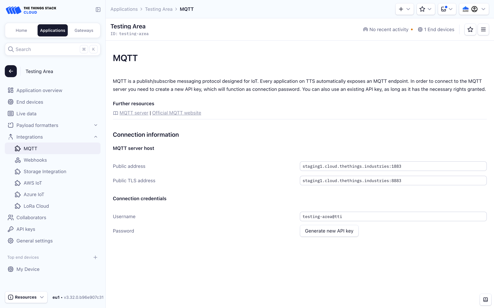
   
2. You can now click on the `Generate new API key` button in order to generate an API key which can be used to send and receive traffic from the MQTT server.   
   **Note:** Make sure to copy your API key now, since it will no longer be visible after leaving the page for security reasons.

   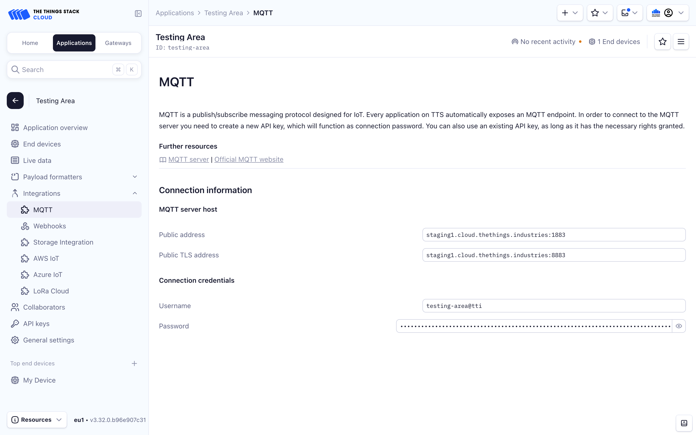

   Keep in mind that this example shows the MQTT Server information for The Things Stack Open Source. If you are using a different deployment, make sure you read a [Note on Using the tenant ID](https://www.thethingsindustries.com/docs/integrations/other-integrations/mqtt/#note-on-using-the-tenant-id). The information shown on the image above is sufficient for you to connect to The Things Stack MQTT Server using an arbitrary MQTT client. Keep reading to find out how. 

### Step 2: Install an MQTT Broker

Choose an MQTT broker, such as Mosquitto for command line or MQTT Explorer for a GUI.

#### Using Mosquitto
- [Download and install the broker on your PC](https://mosquitto.org/download/).
- Use the following command in your terminal:
  ```bash
  mosquitto_sub -h <hostname> -p <port> -u <username> -P <password> -t <topic> -d
  ```
- Example:
  ```bash
  mosquitto_sub -h "thethings.example.com" -p "1883" -u "app1" -P "NNSXS.VEEBURF3KR77ZR.." -t "#" -d
  ```
- For our case:
  ```bash
  mosquitto_sub -h "eu1.cloud.thethings.network" -p "1883" -u "m-zero-daphnis-featherwings" -P "NNSXS…" -t "#" -d
  ```
- This command connects to your TTN application and waits for new publications which are then printed to the terminal.
- **Tip:** When using `mosquitto_sub`, the `-d` flag helps you see the topics messages get published on.
- **Tip:** For testing purposes, using `#` as a topic ensures you avoid naming errors when listening to specific topics.

#### Using MQTT Explorer
- [Download and install MQTT Explorer](https://mqtt-explorer.com/).
- Open MQTT Explorer and enter the settings from the TTN Console `Integrations -> MQTT`.
   
   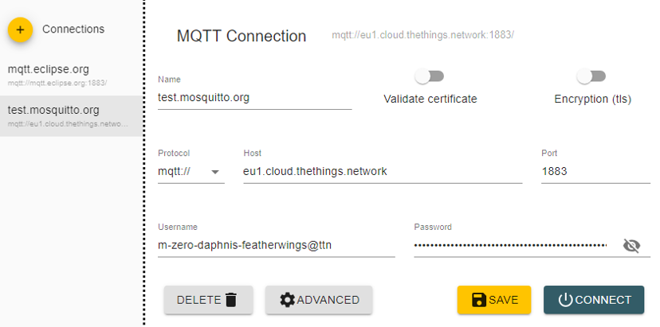

- Navigate to `Advanced Settings`:
   - Add `#` as a topic to listen to all publications. You can later specify this. 
   - Click "Save" after making changes.

   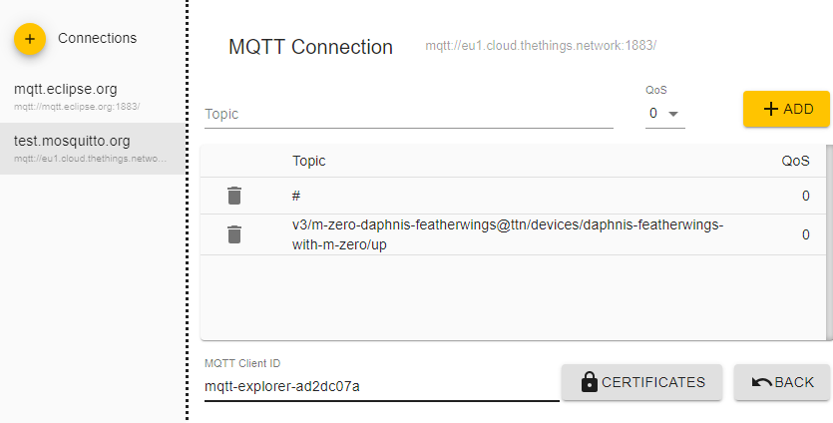

- Connect and Monitor:
   - Click "Connect" and wait for incoming messages.
   - You should see new data published once connected.

   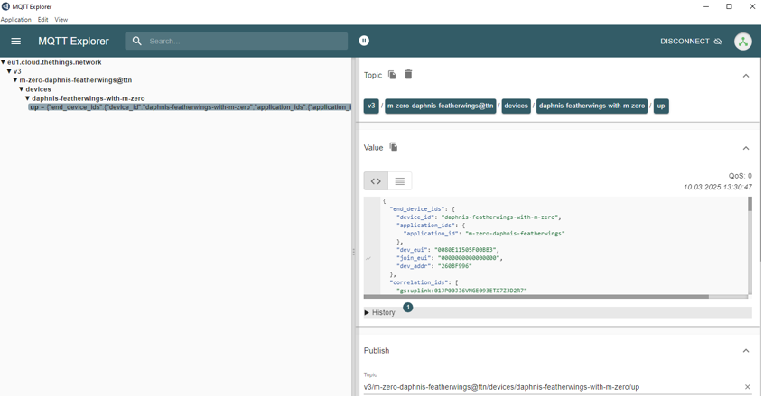

<br>
<br>

# Configuring TTN with AWS 
This section describes how you can integrate AWS with TTN. TTN's functional integration is quick to create an IoT device in AWS with the necessary permissions and already formatted data - provided you have completed the section on how to [deserialize the payload and transform it into JSON format](#deserialize-the-payload-and-transform-into-json-format). Thus, we recommend to use AWS in conjunction with TTN in case you are unfamiliar with AWS.   

If you wish to skip TTN as message broker and directly send messages from the LoRaWan Gateway to the AWS network server, please refer to our [documentation on AWS](../AWS/AWS_integration.md). 

## Features of integrating via TTN 
The key features of the Default Integration are:
- **Handling uplink and downlink messages**: The Things Stack publishes uplink messages to IoT Core and subscribes to downlink messages that you sent from IoT Core. Also, you receive all downlink queued, sent, failed, acknowledged and not acknowledged events in IoT Core.
- **Creating devices**: manage things in IoT Core.
- **Updating device state in shadow**: monitor devices using useful metrics reported in the shadow state, like signal quality and number of covering gateways.

The integration comes with a AWS CloudFormation template to deploy in your AWS account. 

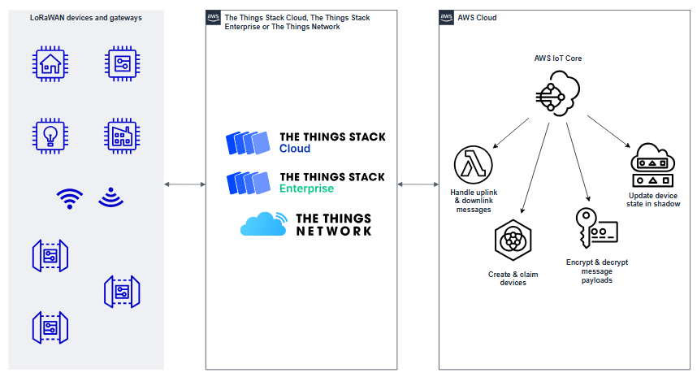

## Prerequisites

For this tutorial you will need the following: 
- A TTN Application with a registered gateway and a registered device. 
- An AWS subscription - if you do not have an AWS subscription yet, please create a free account before you begin. Feel free to use the `free support plan`. 


## AWS Deployment Guide
Please **navigate to the official [AWS IoT Deployment Guide](https://www.thethingsindustries.com/docs/integrations/cloud-integrations/aws-iot/deployment-guide/)** and follow the instructions provided there. 

1. Create an API key for AWS: 
   - Go to your application in The Things Stack Console, go to `API keys` and click on `Add API key`.
   - Enter a name, like `"AWS IoT integration"`, and grant at least the following individual rights (you can also grant all rights):
      - View devices in application
      - View device keys in application
      - Create devices in application
      - Edit device keys in application
      - Edit basic application settings
      - View and edit application packages and associations
      - Write downlink application traffic
      - Read application traffic (uplink and downlink)

   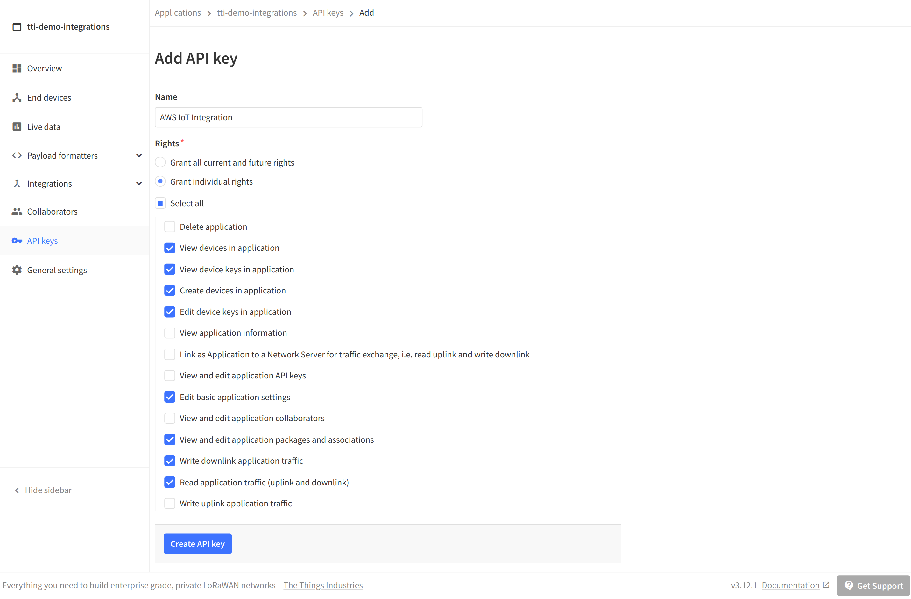


- In the [AWS IoT Deployment Guide](https://www.thethingsindustries.com/docs/integrations/cloud-integrations/aws-iot/deployment-guide/) make sure to select the `Sandbox Version` (or the version you are using) and your `location` here:

   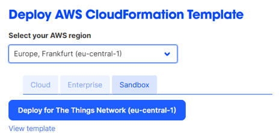

- Then click on `Deploy for the Things Network`. You will have to login on AWS and then be forwarded to the AWS Setup page. 
  
- On the AWS Setup Page you simply have to enter these details: 
  - `Stack Name`: You can choose this freely. 
  - `Cluster Address`: The cluster address of your The Things Stack deployment.
      - When using The Things Stack Cloud, go to The Things Stack Cloud Addresses to find your cluster address
      - When using The Things Stack Enterprise, enter your cluster address
      - When using The Things Network, select the community cluster from the dropdown
  - `Application ID`: The application ID for which you configure the integration. This is shown on TTN under your application at the top of the page. 

      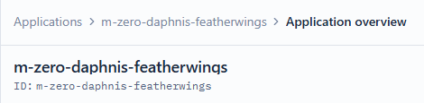

  - `Application API Key`: The application API key that you generated before.

   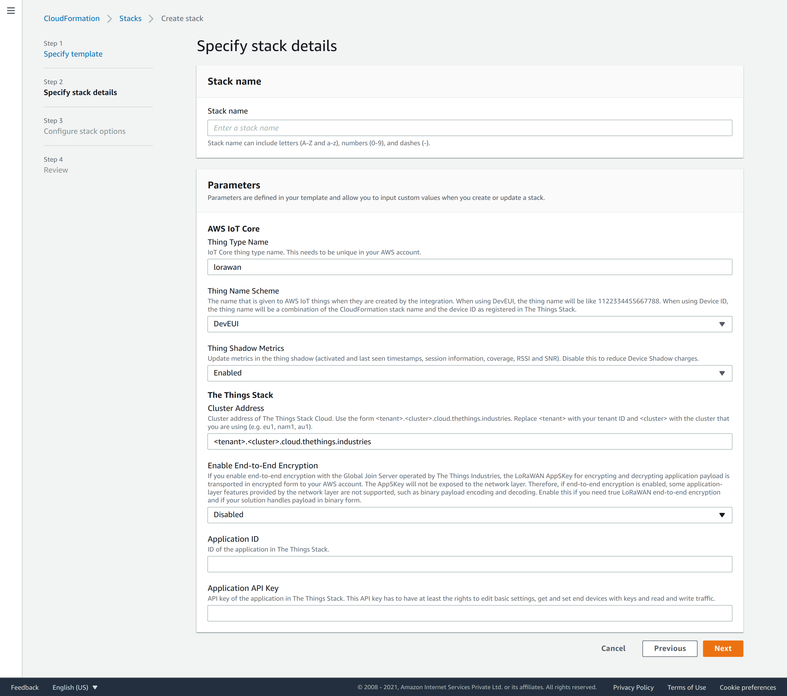

- Check `I acknowledge that AWS CloudFormation might create IAM resources`  and then click on `Create stack`.
- When the deployment is finished, you’ll see the status `CREATE_COMPLETE`.
- It can take a few minutes for AWS to complete the setup. After that you should be able to view your device(s) under the tab `things` in AWS as the TTN integration with AWS ensures that all devices that send uplink data will be automatically registered as things (either with their id name or their Device EUI which you can select in one of the dropdown menus on the AWS setup page mentioned above).

- Navigate to the `MQTT Test Client` tab and subscribe to “#” to view all data sent by your device(s) via LoRaWan.

## Further Resources
[1] AWS Deployment Guide: https://www.thethingsindustries.com/docs/integrations/cloud-integrations/aws-iot/deployment-guide/   
[2] Architecture: https://www.thethingsindustries.com/docs/integrations/cloud-integrations/aws-iot/architecture/


<br>
<br>

# Configuring TTN with Microsoft Azure IoT Hub
This section describes how you can integrate Azure with TTN. TTN's functional integration is quick to create an IoT device in Azure with the necessary permissions and already formatted data - provided you have completed the section on how to [deserialize the payload and transform it into JSON format](#deserialize-the-payload-and-transform-into-json-format). Thus, we recommend to use Azure IoT Hub in conjunction with TTN in case you are unfamiliar with Microsoft Azure.   

**Please note**: Azure IoT Hub does not have the functionality of a LoRaWAN network server (LNS) and needs a message broker like TTN or chirpstack to handle it. 

## Features of integrating via TTN 
The key features of the Azure IoT Hub integration are:
- **Handling uplink messages**: The Things Stack publishes uplink messages to an Azure IoT Hub
- **Creating and deleting devices**: manage end devices in Azure IoT Hub, using the LoRaWAN device repository
- **Updating device state in Device Twin**: update the device reported properties based on the decoded payloads, and schedule downlinks based on the device desired properties

Note: The integration comes with a Azure template to deploy in your Azure account. 

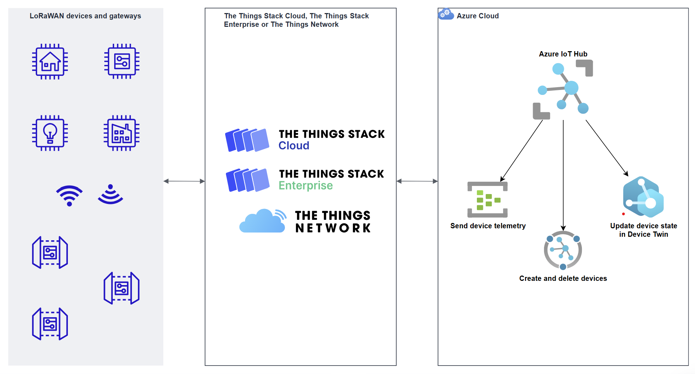

## Prerequisites

For this tutorial you will need the following: 
- A TTN Application with a registered gateway and a registered device. 
- A Microsoft Azure account

## Azure IoT Hub Deployment Guide 
Please **navigate to the official [Azure IoT Hub Deployment Guide](https://www.thethingsindustries.com/docs/integrations/cloud-integrations/azure-iot-hub/deployment/)** and follow the instructions provided there. Alternatively, feel free to follow along here. 

1. Go to your application in The Things Stack Console, navigate to `Integrations → Azure IoT` on the left hand menu and click on Expand next to Azure IoT Hub. Now click on `Generate API Key`.
   
   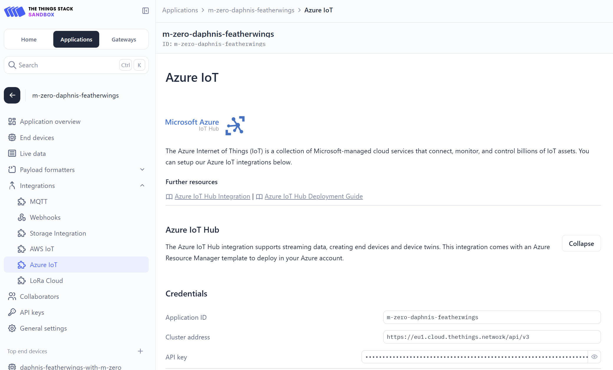

   Copy the generated API key and store it in a safe place, because you will need it in the next section.    
   Leave the integration page open, as you will need to copy in your `Azure IoT Hub hostname` and `Azure IoT Hub access key` before completing the integration. 

2. In the [Azure IoT Hub Deployment Guide](https://www.thethingsindustries.com/docs/integrations/cloud-integrations/azure-iot-hub/deployment/) you simply need to click here to deploy the `Azure Resource Manager Template`:
      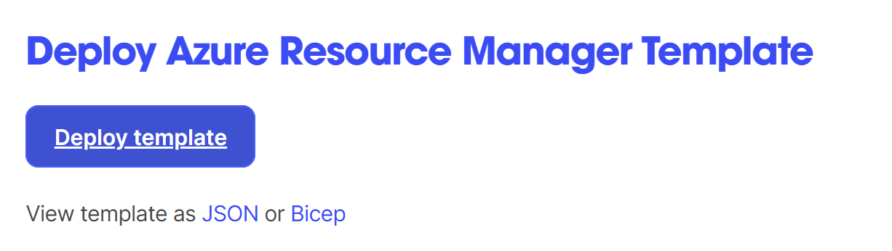

3. You will be forwarded to a setup page on Azure where you will have to enter the following parameters configure the integration:
      *  `Location`: The region in which the Azure resources will be deployed. Defaults to the region used by the selected Resource Group.
      * `Name Suffix`: The suffix added to the Azure Resources. Defaults to a random string.
      * `Stack Cluster Address`: The address of your The Things Stack deployment. Can be retrieved from the Azure IoT integration page in The Things Stack (see image above).
      * '`Application ID`': The application ID of your application. Can be retrieved from the Azure IoT integration page in The Things Stack (see image above).
      * `Stack API Key`: The application API key that you generated in the previous step.
      * `Enable fallback route`: Defines if the Azure IoT Hub fallback route should be added. If enabled, uplink messages will be submitted to the default events endpoint in your Azure IoT Hub.

   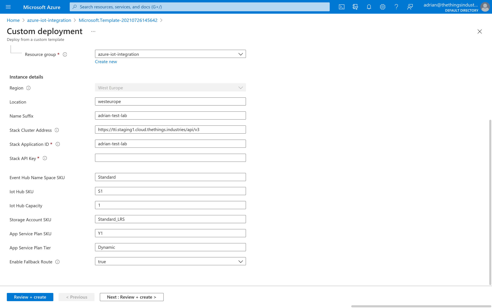

4. Click `Review + Create`, then `Create`.
5. **Note:** Creating all resources can take up to five minutes. When the deployment is done, you’ll see the status `Your deployment is complete`.
6. After the deployment has finished, click on `Outputs` in the left side panel.

   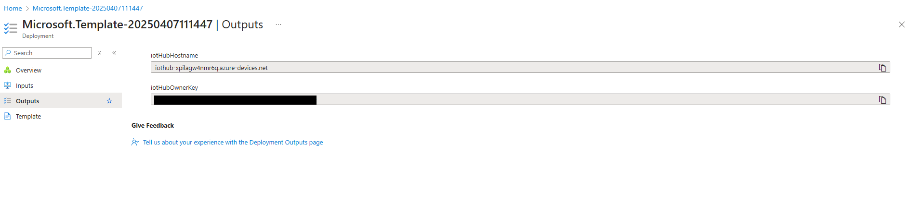

7. The two outputs can now be copied into your integration settings as `Azure IoT Hub hostname` and `Azure IoT Hub access key.` 
   
   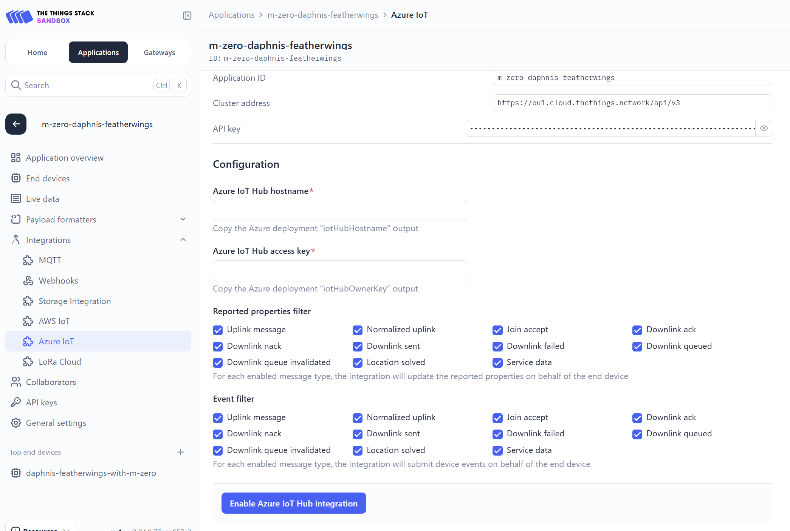

8. Finally, click on `Enable/Update Azure IoT Hub integration`. And your setup is complete. You should now see the data in Microsoft Azure IoT Hub. 


## Further Resources
[1] Azure Iot Hub Deployment Guide: https://www.thethingsindustries.com/docs/integrations/cloud-integrations/azure-iot-hub/deployment/   
[2] Architecture: https://www.thethingsindustries.com/docs/integrations/cloud-integrations/azure-iot-hub/architecture/

<br>
<br>

# Configuring TTN with KaaIoT
This section describes how you can integrate KaaIoT with TTN. TTN's functional integration is quick to create an IoT device in KaaIoT with the necessary permissions and already formatted data - provided you have completed the section on how to [deserialize the payload and transform it into JSON format](#deserialize-the-payload-and-transform-into-json-format). Thus, we recommend to use KaaIoT in conjunction with TTN in case you are unfamiliar with KaaIoT. 
**Please note**: KaaIoT does not have the functionality of a LoRaWAN network server (LNS) and needs a message broker like TTN or chirpstack to handle it. 

## Features of integrating via TTN 
The key features of the KaaIoT integration are:
- **Handling uplink messages**: The Things Stack publishes already formatted uplink messages to a KaaIoT
- **Creating and deleting devices**: manage end devices in KaaIoT, using the LoRaWAN device repository
- **Updating device state in Device Twin**: update the device reported properties based on the decoded payloads, and schedule downlinks based on the device desired properties 

## Prerequisites

For this tutorial you will need the following: 
- A TTN Application with a registered gateway and a registered device. 
- A KaaIoT account 


## KaaIoT Deployment Guide 
Please **navigate to the official [KaaIot Deployment Guide for TTN](https://www.kaaiot.com/docs/tutorials/device-integration/connecting-ttn-lora-device-to-kaa)** and follow the instructions provided there. Alternatively, feel free to follow along here.

1. On TTN in your console under the tab `MQTT Integration` inside your application, create an API key. Remember to copy and save your key. 

   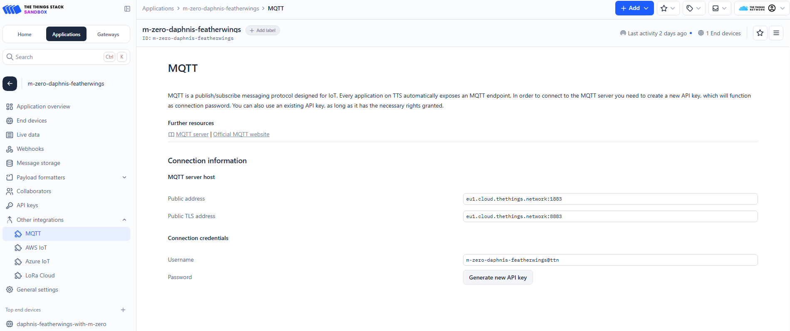

2. Now, you need to set the necessary permissions for the newly created MQTT key. For that navigate to the `API keys` tab and click on `Edit`. Check the box that says `Grant all current and future rights` and click on `save changes`. 

   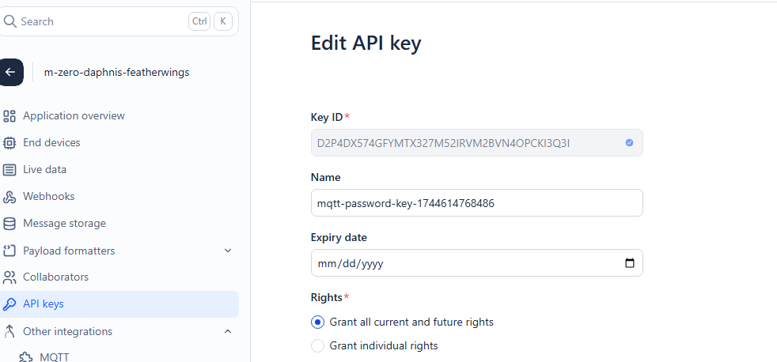

   > **Warning:**
   > Kaa only works with the data represented in JSON format. For the next steps to work, it is required of you to format the data payload as JSON on TTN before it is forwarded. If you have not done so already please complete the section on how to [deserialize the payload and transform it into JSON format](#deserialize-the-payload-and-transform-into-json-format). 

3. Now, please switch over to [Kaa cloud](https://cloud.kaaiot.com/). 
4. To start with, you should create an application integration between the Kaa and TTN applications. To do so, let us first create a new Kaa application to match the previously created TTN application. Go to the `Device management -> Applications` section in the Kaa web dashboard and click on `Add application`. Give it a name of your choice and then click on `Create application`. 

   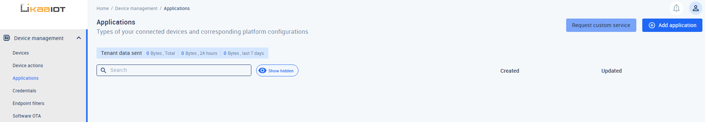

   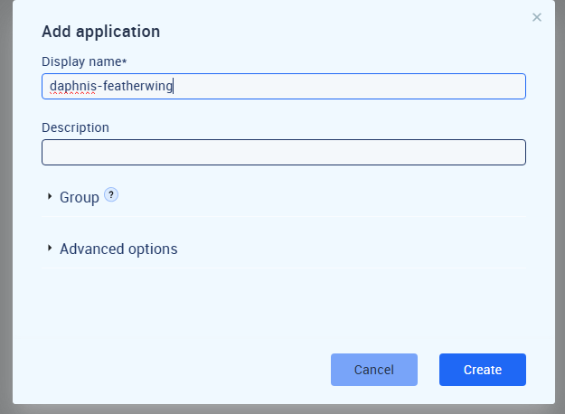

5. Next, we want to create a device. Head to the `Device management -> Devices` section and in the top right corner select the correct application from the dropdown menu. Then, click on `Add device`. Give it a name and leave the token field blank as Kaa will automatically create the token for you. Lastly, click on `Create application`. Make sure that you copy and store the token that was generated. 

   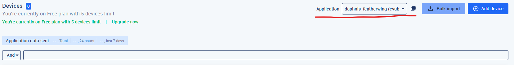

   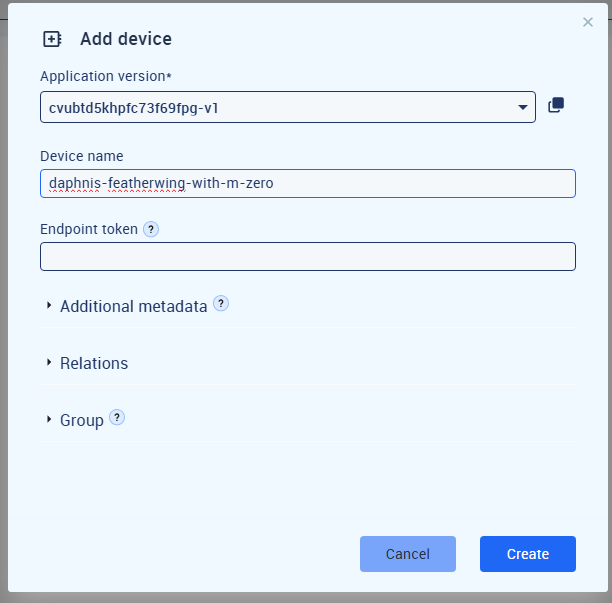

6. After the application and the device are created, let us set up the integration. Navigate to the `LoRaWAN` tab in the dashboard and click on `Add Integration`.

   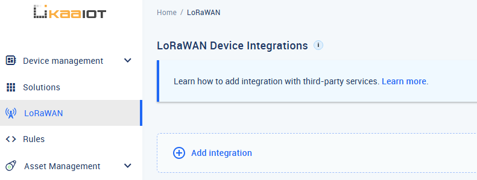

7. Here, you must fill the following fields: 
   1. The **`Name of the integration`** can be freely chosen. 
   2. **`TTN username`** of MQTT integration for the previously created TTN application.
      - TTN username must follow the format: <TTN application ID>@<tenant ID>.
      - The Tenant ID for The Things Network Community Edition is `ttn`. More details about TTN tenant IDs [here](https://www.thethingsindustries.com/docs/integrations/mqtt/#note-on-using-the-tenant-id).
      - In our case that means: `m-zero-daphnis-featherwings@ttn`
   3. **`TTN API key`** is your previously generated TTN MQTT integration API Key for the current application.
   4. **`Identity Server Host`** address. The Identity Server APIs are only available in the eu1 cluster. The default values are:
      - `eu1.cloud.thethings.network` for The Things Network Community Edition
      - `<tenant>.eu1.cloud.thethings.industries` for The Things Network Cloud deployment, where `<tenant>` is your Tenant ID
   5. **`MQTT Server Host`** is the “Public address” of TTN MQTT integration which is `eu1.cloud.thethings.network:1883`
   
   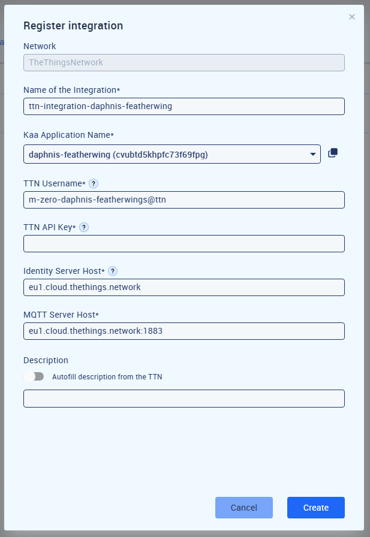

   >**Note:**
   > You can look up values of the `TTN username`, `TTN API key` and `MQTT Server Host` fields under the TTN MQTT integration menu.

   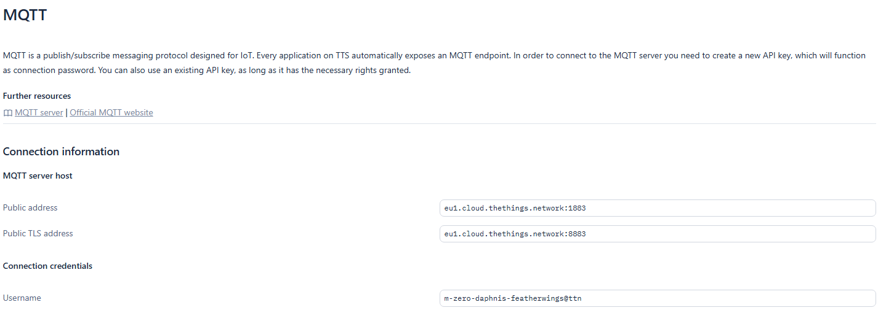


8. Now that the application integration is done, you can create mappings between TTN devices and Kaa endpoints. Navigate to the created application integration and create a device mapping choosing the application version from the dropdown and TTN device that you want to map.

   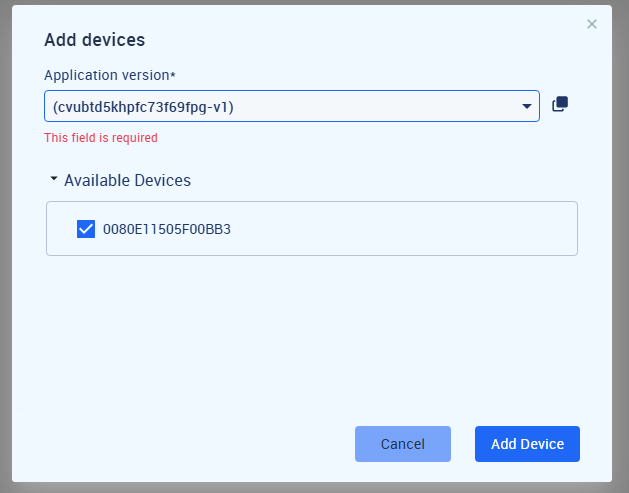

9. A mapping should have been created and appear under the `Devices` list. If you go to the `Device management` dashboard you can now see an endpoint that was created automatically. All incoming data from the TTN device will be ingested under that endpoint. Your setup is complete now

   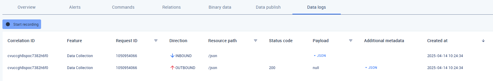


If you wish to also send downlink data, please refer to the official documentation as mentioned above or see the further resources. 

<br>

## Further Resources
[1] TTN MQTT integration - https://www.thethingsindustries.com/docs/integrations/other-integrations/mqtt/   
[2] Kaa LoRaWan Deployment Guide - https://www.kaaiot.com/docs/tutorials/device-integration/connecting-ttn-lora-device-to-kaa