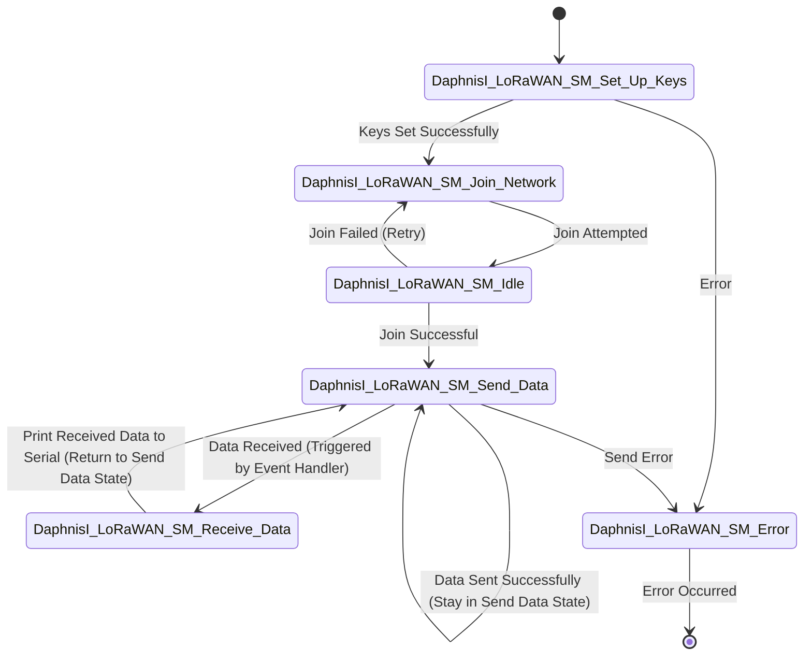

# Daphnis-I LoRaWAN FeatherWing
This example demonstrates creation of a secure connection between the Daphnis-I FeatherWing and a LoRaWAN Network Server. Further, the sensor data is transmitted to any cloud platform via the LNS. Choose the platform of your choice and set it up as described in the corresponding document.

1. [TTN](Documentation/TTN/TTN_integration.md)
2. [AWS](Documentation/AWS/AWS_integration.md)
3. [Microsoft Azure IoT Hub](Documentation/Azure/Azure_integration.md)
4. [Kaa IoT](Documentation/Kaa_IoT/Kaa_IoT.md)

## Introduction

The [Daphnis-I FeatherWing](https://www.we-online.com/DAPHNIS-I_FEATHERWING_KIT) was designed with rapid prototyping in mind. Being fully compatible with the Adafruit ecosystem, this FeatherWing gives the user the flexibility to choose the preferred host microcontroller. The inherent modularity of the ecosystem allows the FeatherWing to be easily integrated into any project.

Würth Elektronik eiSos provides a Software Development Kit (SDK) with examples to support all WE FeatherWings. Here are the salient features of the WE FeatherWing SDK. 
* The SDK is **open-source** and well-documented.
* It uses popular open-source tool chain including an IDE.
* The examples are written in Arduino-style C/C++ for easy understanding.
* The core components of the SDK are written in pure C to enable easy porting to any microcontroller platform.
* Modular structure of the software stack makes it easy to integrate into any project.

### Software components

* **Install IDE**: your favourite development IDE (we recommend [Visual Studio Code](https://code.visualstudio.com/) with [Platform IO](https://platformio.org/) extension.
* **PlatformIO**: is a cross-platform, cross-architecture, multi-framework professional tool for embedded software development. It provides the tool chain necessary for the software development including building, debugging, code-upload and many more. PlatformIO works well on all the modern operating systems and supports a host of development boards including the Feathers from Adafruit. Further details about PlatformIO can be found under [platformio.org](https://platformio.org/).
* **WE SDK**: This is a layer of platform-independent pure C drivers for sensors and wireless connectivity modules from Würth Elektronik eiSos. These drivers implement all the necessary functions to utilize full feature set of the sensors and wireless connectivity modules. More details on the SDK and downloads under [WCS Software](https://we-online.com/wcs-software).
* **Board files**: This layer provides abstraction at a board level and provides functions to configure and control individual FeatherWings from WE.
* **User application**: The SDK currently implements a quick start example for each of the FeatherWings.

### Installing the tools

* Install Visual Studio Code on the platform of your choice following the [instructions](https://code.visualstudio.com/docs).
* Follow the instructions to install the [PlatformIO IDE](https://platformio.org/platformio-ide) extension.


### Quick-start example

The quick start example for the Daphnis-I FeatherWing demonstrates a connection to LoRaWAN Network Servers like TTN and data transmission. For simplicity, we recommend beginning with a connection to [The Things Network (TTN)](https://www.thethingsnetwork.org/) and build from thereon. A message broker like TTN provides the  LoRaWAN network server (LNS) functionality. The data can be forwarded from here to any cloud platform, such as AWS using standard protocols like MQTT. 

1. Prerequisites for running this example:
    * A Wi-Fi access point with WPA2 personal security and a known password. 
    * A LoRaWAN Gateway which has already been registered with:
      * [TTN](Documentation/TTN/TTN_integration.md)
      * [AWS](Documentation/AWS/AWS_integration.md)

2. Configuration: The following parameters need to be set-up before building the code:
    * The `Application Key`
    * The `Application EUI` (also called `Join EUI` in older versions)
    
    After having completed the integration with either cloud platform, you should have knowledge of what your unique Application Key and your App/Join EUI is. Now, navigate to the [DaphnisIFeatherWingExample.c source file](/lib/WE_DaphnisIFeatherWing/src/DaphnisIFeatherWingExample.c) and set the values accordingly. 
    
    **IMPORTANT**: The keys have to be input as a hex array with LSB (Least-Significant-Byte) first.
    For instance: 
    ```
    // A key in string format will look like this as a hex array with LSB first:
    "EFCDAB8967452301" --> {0x01, 0x23, 0x45, 0x67, 0x89, 0xAB, 0xCD, 0xEF}
    ```

```C
// in DaphnisIFeatherWingExample.c

// TODO BY THE USER - be sure to convert key string to hex byte array WITH LSB FIRST!
static DaphnisI_EUI_t appEUI = {0x01, 0x23, 0x45, 0x67, 0x89, 0xAB, 0xCD, 0xEF}; // Placeholder
static DaphnisI_Key_t appKey = {0x01, 0x23, 0x45, 0x67, 0x89, 0xAB, 0xCD, 0xEF, 0x01, 0x23, 0x45, 0x67, 0x89, 0xAB, 0xCD, 0xEF}; //Placeholder
```
3. Setup: The debug as well as the Daphnis-I UART interfaces are initialized. The Daphnis-I is configured with the given parameters. Further, the module attempts to connect to the LoRaWAN network servers via the Gateway. 

```C
void setup() {
    // Delay for 5 seconds to allow any necessary startup processes to complete
    delay(5000);

#if ((WE_DEBUG_PRINT_LEVEL > WE_Debug_Print_Level_Off) || \
     defined(WE_APP_PRINT_ENABLED))
    WE_Print_Init();
#endif

    // Initialize the Daphnis-I module with the configured UART and pin settings
    if (!DaphnisI_Init(&DaphnisI_uart, &DaphnisI_pins,
                       DaphnisI_OTAA_EventCallback)) {
        WE_APP_PRINT("Daphnis Initialization Failed\r\n");
        exit(0);
    }

    DaphnisI_Mode_t daphnisI_mode;

    // Get the current mode of the Daphnis-I module
    if (!DaphnisI_GetModeRS(&daphnisI_mode)) {
        WE_APP_PRINT("Failed to get current mode\r\n");
        exit(0);
    }

    // Check if the current mode is not LoRaWAN
    if (daphnisI_mode != DaphnisI_Mode_LoRaWAN) {
        // Set the mode to LoRaWAN if it is not already set
        if (!DaphnisI_SetModeUS(DaphnisI_Mode_LoRaWAN)) {
            WE_APP_PRINT("Failed to set mode\r\n");
            exit(0);
        }
        // Reset the Daphnis-I module to apply the new mode
        if (!DaphnisI_PinReset()) {
            WE_APP_PRINT("Failed to reset module\r\n");
            exit(0);
        }
    }

    // Initialize the sensors
    if (!DaphnisI_Featherwing_SensorSetup()) {
        WE_APP_PRINT("Sensor Initialization Failed\r\n");
        exit(0);
    }
}
```
4. In the main application, DaphnisI_Featherwing_OTAA_Session function is called. It is a state machine that handles the basic functionality of a LoRaWAN OTAA (Over-The-Air Activation) session. It sets up the necessary keys, joins the network, and manages the transmission and reception of data. In case of errors, it transitions to an error state.

**IMPORTANT**: If you have not yet received your DeviceEUI, it will be printed out in the serial terminal for you to copy each time you run the code. 

**You will need the DeviceEUI later for registering the Daphnis-I module on the network server of the cloud provider of your choice.**  

#### State Diagram of the example code: 



#### The function that implements the state machine: 
```C
void DaphnisI_Featherwing_OTAA_Session(void) {
    bool ret = false;
    while (1) {
        switch (currentState) {
            case DaphnisI_LoRaWAN_SM_Set_Up_Keys: {
                ret = true;

                // Read and print Device EUI for user to copy
                DaphnisI_EUI_t device_eui;
                ret &= DaphnisI_LoRaWAN_GetDeviceEUI(&device_eui);
                WE_APP_PRINT("Device EUI is ");
                for (int8_t i = DAPHNISI_LoRaWAN_EUI_LENGTH - 1; i > 0; i--) {
                    WE_APP_PRINT("%02X:", device_eui[i]);
                }
                WE_APP_PRINT("%02X\r\n", device_eui[0]);

                // Setting the keys
                ret &= DaphnisI_LoRaWAN_SetAPPEUI(appEUI);
                ret &= DaphnisI_LoRaWAN_SetKey(DaphnisI_KeyType_APP, appKey);
                currentState = ret ? DaphnisI_LoRaWAN_SM_Join_Network
                                   : DaphnisI_LoRaWAN_SM_Error;
                break;
            }
            case DaphnisI_LoRaWAN_SM_Join_Network: {
                ret = true;
                ret &= DaphnisI_LoRaWAN_Join(DaphnisI_JoinMode_OTAA);
                currentState =
                    ret ? DaphnisI_LoRaWAN_SM_Idle : DaphnisI_LoRaWAN_SM_Error;
                break;
            }
            case DaphnisI_LoRaWAN_SM_Send_Data: {
                ret = true;
                // Set payload size depending on what data shall be transmitted
                uint8_t payload[24];
                uint8_t index = 0;

                // Read sensor data and convert the data to LoRaWAN data payload
                // format
                DaphnisI_Featherwings_ReadAndConvertSensorData(payload, &index);

                // Send the data via LoRaWAN
                ret &= DaphnisI_LoRaWAN_Send(1, payload, index, false);

                currentState = ret ? DaphnisI_LoRaWAN_SM_Send_Data
                                   : DaphnisI_LoRaWAN_SM_Error;

                int transmission_delay = 60000;
#ifdef TRANSMIT_FREQ
                transmission_delay = TRANSMIT_FREQ;
#endif
                WE_Delay(transmission_delay);  // Transmit one package every 60
                                               // seconds by default
                break;
            }
            case DaphnisI_LoRaWAN_SM_Receive_Data: {
                WE_APP_PRINT("%i bytes received on on port %i: %s\r\n",
                             rxData.dataLength, rxData.port, rxData.data);
                currentState = DaphnisI_LoRaWAN_SM_Send_Data;
                break;
            }
            case DaphnisI_LoRaWAN_SM_Error: {
                WE_APP_PRINT("Error occurred\r\n");
                return;
            }
            default:
                break;
        }
    }

    return;
}
```
5. This function handles event notifications received during the LoRaWAN OTAA session. It operates as an interrupt to update the state machine based on various events, such as startup, successful or failed network join, and data reception. The function ensures that the code remains simple and avoids sending AT commands within the event handler, maintaining efficient and responsive operation. Note that we only transition to the data send mode, once we have successfully joined the network. 
```C
void DaphnisI_OTAA_EventCallback(DaphnisI_ATEvent_t event, char *eventText) {
    switch (event) {
        case DaphnisI_ATEvent_StartUp: {
            currentState = DaphnisI_LoRaWAN_SM_Set_Up_Keys;
            break;
        }
        case DaphnisI_ATEvent_LoRaWAN_JoinState_Success: {
            currentState = DaphnisI_LoRaWAN_SM_Send_Data;
            break;
        }
        case DaphnisI_ATEvent_LoRaWAN_JoinState_Fail: {
            currentState =
                DaphnisI_LoRaWAN_SM_Join_Network;  // try joining again ->
                                                   // devnonce could be an issue
            break;
        }
        case DaphnisI_ATEvent_LoRaWAN_RxData: {
            currentState =
                DaphnisI_LoRaWAN_ParseRxDataEvent(&eventText, &rxData)
                    ? DaphnisI_LoRaWAN_SM_Receive_Data
                    : DaphnisI_LoRaWAN_SM_Error;
            break;
        }
        default:
            break;
    }
}
```
6. In case the user prefers a different transmission frequency of the sensor data (the default is every 60 seconds), this parameter can be passed as a build flag: 
```Javascript
// platformio.ini file
build_flags =       
    -Wl,-u_printf_float 
    -D SERIAL_BUFFER_SIZE=1024 
    -D SERIAL_DEBUG=1 
    -D WE_DEBUG_PRINT_LEVEL=3
    -D WE_APP_PRINT_ENABLED 
    -D M0Express 
    -D UART_RXPin0_TXPin1
    -D WE_USE_FLOAT
    -D TRANSMIT_FREQ=60000 
    -Wall
```

7. Now you can test whether the Daphnis-I can join the network. To do this, see the following section on how to run the example. In the serial monitor, observe the logs. You should see the following if you have connected successfully: 
    ```
    > AT+JOIN=1
    < OK
    < +JOIN:JOINED
    ```


8. After a successful join, the current_state is updated to the send mode and the sensor data byte array will be transmitted. 
   ```
    > AT+SEND=1:0:1A
    < OK
   ```
   
   You can then view the payload byte array in your network server console under `your_device->data` (on TTN) or in the `MQTT Test Terminal` (on AWS/Azure). 
   For instance on TTN there should be a message like this in the data console: 

   

9.  For formatting the payload to the desired format, see detailed information in our documentation under [TTN](/Documentation/TTN/TTN_integration.md) or [AWS](/Documentation/AWS/AWS_integration.md).


### Running the Example
The quick start examples in the SDK are written to be run on Adafruit Feather M0 express. The hardware setup is as simple as stacking up the SensorFeatherWing on top of the M0 Feather and these two boards on top of the Daphnis-I FeatherWing. Then, power up the board.

1. Clone or download the code.
2. Open the workspace of interest with the filename `<FeatherWing>.code-workspace` in Visual Studio Code.
3. Build and upload the code from the PlatformIO tab, as shown in the Figure below
4. After successful upload, click on **Monitor** in PlatformIO extension tab to view the debug logs in the serial terminal.

   